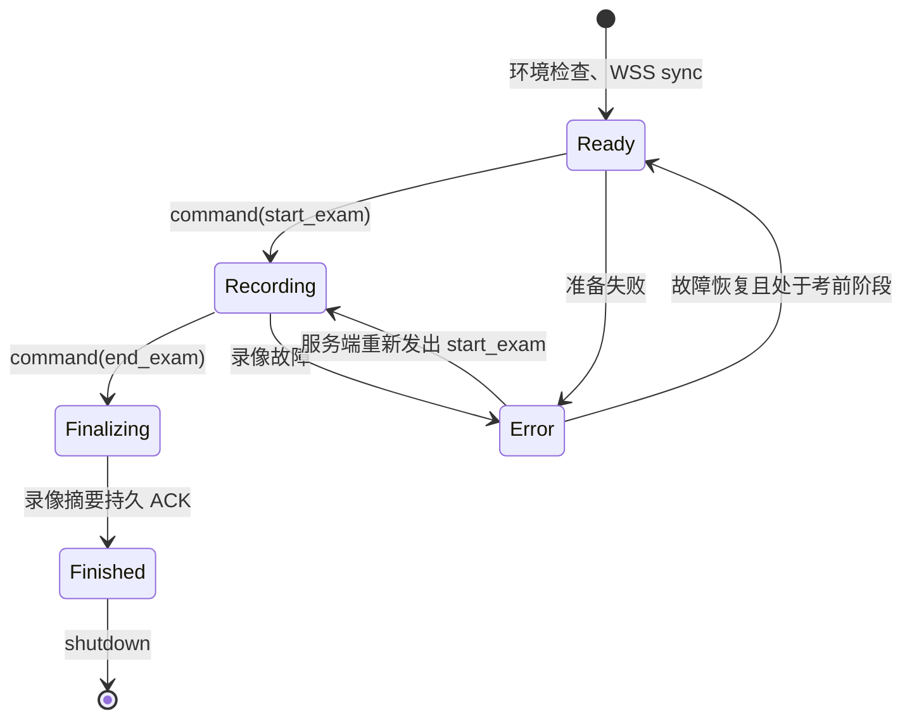

# cvbbmso-exam — 客户端考试运行时

本 crate 管理客户端参加单场考试的运行过程：建立 WebSocket、响应服务端命令、驱动录像、周期性检查网络、维护本地可靠事件队列及断线恢复。运行时直接以 `exam_id` 连接监考服务端，考生身份由 Cookie 验证得到；业务标识为 `(exam_id, oj_user_id)`。

本文档定义公开接口、运行时职责和跨模块行为；本地表结构、任务划分和重连算法由实现负责。

## 公开 Rust API

```rust
pub struct ExamConfig {
    pub server_base: url::Url,
    pub app_data_dir: std::path::PathBuf,
    pub device_id: uuid::Uuid,
    pub instance_id: uuid::Uuid,
}

pub struct Exam;
pub struct ExamHandle { /* 私有运行时句柄 */ }

pub enum ExamError {
    Http,
    WebSocket,
    Auth,
    NotEnrolled,
    Recording,
    Storage,
    Closed,
}

pub enum UiNotice {
    CookiesUpdated(cvbbmso_accoding::AccodingCookies),
    NavigationDenied { target_origin: String },
}

pub struct ClientView {
    pub exam_id: uuid::Uuid,
    pub connected: bool,
    pub state: cvbbmso_protocol::ClientState,
    pub last_error_code: Option<String>,
}

impl Exam {
    /// 用指定考试 ID 和 Accoding Cookie 建立或恢复考试运行时。
    /// 返回时已完成初始 sync；之后由内部任务持续维护连接、录屏与事件队列。
    pub async fn connect(
        config: ExamConfig,
        exam_id: uuid::Uuid,
        cookies: cvbbmso_accoding::AccodingCookies,
    ) -> Result<ExamHandle, ExamError>;
}

impl ExamHandle {
    /// 订阅只读状态快照，供受信任的本地 UI 展示。
    pub fn subscribe(&self) -> tokio::sync::watch::Receiver<ClientView>;

    /// 提交 Cookie 更新或浏览器拒绝导航通知。
    pub async fn notify(&self, notice: UiNotice) -> Result<(), ExamError>;

    /// 停止运行时、关闭 WebSocket 并保留已封存分片；最终 manifest 由 Recorder::finish 生成。
    pub async fn shutdown(self) -> Result<(), ExamError>;
}
```

`Exam::connect` 首先调用 `GET /api/exams` 确认用户身份和考试报名，以返回的 `user.id` 定位本地 `(exam_id, oj_user_id)` 数据，然后建立 WSS 并等待初始 `sync`。`ExamConfig.instance_id` 由客户端进程启动时生成，在该进程的所有重连中保持一致；`device_id` 是持久设备标识。`Exam::connect` 是该 crate 的唯一启动入口。

`ExamError` 是运行时错误类别：`Auth` / `NotEnrolled` 对应认证与报名错误，`Http` / `WebSocket` / `Recording` / `Storage` 对应连接、录像或存储失败，`Closed` 表示句柄已关闭。

网络检查、WebSocket 读写、录像控制与本地存储均属于内部状态机；`ExamHandle` 提供状态订阅、UI 通知和关闭。一个客户端进程内每个 `exam_id` 最多有一个活跃 `ExamHandle`，客户端整体同时承载一场活动考试。

## WebSocket 协作

| 时机 | 接口与消息 | 运行时职责 |
| --- | --- | --- |
| 入场 | `GET /api/exams/{exam_id}/ws` | 传递原生 Cookie，建立单条 WSS |
| 建连 | `hello` → `sync` | 上报设备与进程实例、恢复服务端确认位置 |
| 考前 | `status` | 上报 `ready` 及网络、录像状态 |
| 到开始时间 | `command(start_exam)` | 调用 `Recorder::start`，回报 `command_result` |
| 考试中 | `heartbeat`、`status`、`event` | 保持长连接，可靠上报分片与异常 |
| 到结束时间 | `command(end_exam)` | 调用 `Recorder::finish`，上报最终摘要 |
| 完成 | `ack`、`command_result` | 事件持久确认后进入 `finished` |

字段及消息 Schema 由 [cvbbmso-protocol](cvbbmso-protocol.md) 唯一定义。客户端每 5 秒发送无载荷心跳，业务事件按 `seq` 递增并先持久化后发送。服务器 `ack_event_through` 代表已保存的最大连续序号，收到确认后本地删除相应待发送事件。指令结果按 `command_id` 去重；服务端重发同一 ID 时，客户端按该 ID 幂等执行。

## 运行状态



`execution` 表示考试运行阶段，`recording` 表示采集阶段；二者需要保持一致：

- `execution = recording` 时 `recording = capturing`。
- `execution = finalizing` 时 `recording = finalizing`。
- `execution = finished` 时 `recording = complete` 或 `failed`。
- `execution = error` 可以与 `recording = failed` 同时出现。

连接状态独立于录制状态。WSS 中断后，已运行的录屏任务继续执行，事件继续写入本地队列；重连并完成 `hello/sync` 后恢复待确认事件传输。

## 生命周期、离线与认证

- **正常完成**：收到 `end_exam` 后停止采集、合并并上报 `recording_finalized`；最终摘要 ACK 后进入 `finished`，随后关闭 WebSocket。这次关闭按正常完成处理，`connection_lost` 由异常断开产生。
- **主动关闭**：`ExamHandle::shutdown` 停止运行时、关闭连接并保留已封存分片；最终 manifest 由 `finish` 生成，客户端 UI 通过 `close_exam` 调用。
- **断网跨过结束时间**：客户端使用 `sync.server_time` 计算服务端时钟偏移；到达 `end_at + 60s` 后停止采集并封存。重连后补报事件，并按服务端补发的 `end_exam` 完成收尾。
- **Cookie 过期**：运行时继续录屏，保持本地事件队列；通过 `ClientView` 通知 UI 重新登录，并按退避策略重试连接。认证失效期间录像继续。
- **服务端重启**：客户端按正常重连流程恢复；服务端记录 `connection_lost`（`detail = server_restart`）和 `connection_restored`。

## 网络与录屏策略

- 进入考试前，客户端调用 `cvbbmso-network::Inspector::check`；进入考试流程的条件是 `NetworkState::Clear`。检测到代理、服务端不可达或状态未知时，客户端停留在考试外，展示对应错误。
- 考试中默认每 30 秒检查一次网络；发现代理或检查失败时，通过 `ExamEvent::Incident` 上报 `proxy_detected` / `proxy_check_failed`，考试继续。网络恢复后发送新的 `status` 快照。
- 录屏采集范围为主显示器，音频关闭。采集、编码或写盘失败时，上报 `recording_failed`，停止录像，考试继续；恢复后可作为独立 `recording_recovered` 证据上报。

## 本地数据所有权

本 crate 管理 `<app-data>/exams/<exam-id>/<oj-user-id>/` 下的运行时数据：考试运行状态、已执行命令结果、待 ACK 的可靠事件队列。录像文件和分片元信息属于 [cvbbmso-recorder](cvbbmso-recorder.md)，位于同一考生目录下的 `recording/`。

分片事件以 `SegmentMeta.index` 作为稳定身份；重启后 `Recorder::open` 会重新发出已恢复分片，运行时可以安全重报，服务端按 `(exam_id, oj_user_id, index)` 去重。本地运行时数据由本 crate 管理，存储细节封装在 crate 内部；对客户端和其他 crate 提供运行时接口。
