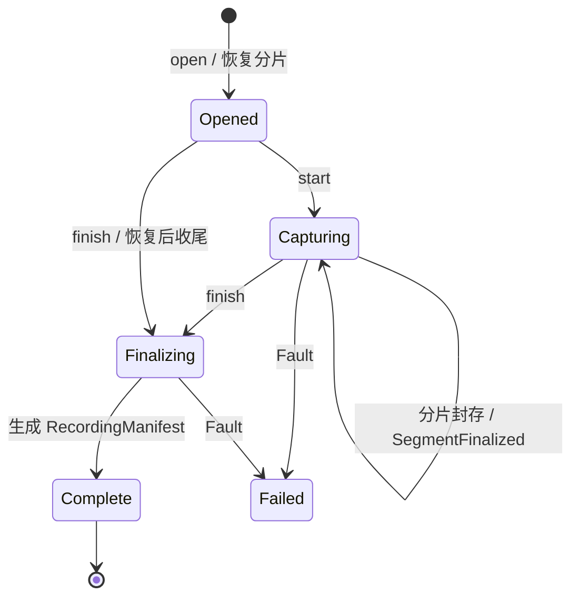

# cvbbmso-recorder — 屏幕录制与录像摘要

本 crate 管理 Windows/macOS 主显示器录屏、分片落盘、异常恢复、合并和 SHA-256 计算。Windows 采用 Desktop Duplication，macOS 采用 ScreenCaptureKit；视频采用 H.264，分片封装为 MKV，最终产物为 MP4。录屏范围为主显示器，音频关闭，文件保留在本地。

编码、容器和系统桥接均为私有实现；本文档定义公开接口、本地文件约定和故障行为。

## 公开 Rust API

```rust
use tokio::sync::mpsc::Receiver;

pub struct Recorder { /* 私有录制状态 */ }

pub enum RecorderEvent {
    SegmentFinalized(cvbbmso_protocol::SegmentMeta),
    Fault(RecordingError),
}

pub enum RecordingError {
    Io,
    Platform,
    Encoder,
    NoSegments,
    Merge,
}

impl Recorder {
    /// 打开考生录像目录并恢复已封存分片。
    /// 返回的接收端从 open 起即可接收恢复分片事件。
    pub async fn open(
        exam_id: uuid::Uuid,
        oj_user_id: i64,
        candidate_dir: std::path::PathBuf,
        policy: cvbbmso_protocol::RecordingPolicy,
    ) -> Result<(Self, Receiver<RecorderEvent>), RecordingError>;

    /// 开始或恢复主显示器录制；已处于采集状态时幂等。
    pub async fn start(&mut self) -> Result<(), RecordingError>;

    /// 停止采集、封存剩余片段、合并视频并返回完整摘要。
    /// 已完成后重复调用返回同一 manifest；分片清单为空时返回 NoSegments。
    pub async fn finish(
        &mut self,
    ) -> Result<cvbbmso_protocol::RecordingManifest, RecordingError>;
}
```

`candidate_dir` 是考生目录 `<app-data>/exams/<exam-id>/<oj-user-id>/`，由运行时传入；`Recorder` 在其中创建 `recording/`。`open` 读取并恢复已封存分片，恢复分片按 `index` 升序通过接收端发送 `SegmentFinalized`，运行时据此补报事件。

`start` 由运行时在收到 `start_exam` 后调用；`finish` 由 `end_exam` 触发。`RecorderEvent::SegmentFinalized` 在分片文件和元信息保存完成后发送；`Fault` 表示采集、编码或写盘失败，运行时将其转换为 `recording_failed` 异常。WebSocket、事件序号和异常记录由运行时负责。

## 文件与分片元信息

```text
<app-data>/exams/<exam-id>/<oj-user-id>/recording/
├── segments/
│   ├── 000001.mkv
│   ├── 000001.json
│   ├── 000002.mkv
│   └── 000002.json
└── final.mp4
```

分片元信息由 [cvbbmso-protocol](cvbbmso-protocol.md) 的 `SegmentMeta` 定义，`index` 从 1 开始并与文件名序号一致：

```json
{
  "index": 1,
  "start_at": "2026-12-20T01:00:00Z",
  "end_at": "2026-12-20T01:00:30Z",
  "sha256": "aaaaaaaaaaaaaaaaaaaaaaaaaaaaaaaaaaaaaaaaaaaaaaaaaaaaaaaaaaaaaaaa"
}
```

`start_at` / `end_at` 是该片段实际录制的起止 UTC 时间；`sha256` 是 `NNNNNN.mkv` 封存后整个文件的 SHA-256。`RecordingManifest` 按 `index` 升序列出所有片段，并携带合并后 `final.mp4` 整个文件的 `merged_sha256`。

```json
{
  "segments": [{
    "index": 1,
    "start_at": "2026-12-20T01:00:00Z",
    "end_at": "2026-12-20T01:00:30Z",
    "sha256": "aaaaaaaaaaaaaaaaaaaaaaaaaaaaaaaaaaaaaaaaaaaaaaaaaaaaaaaaaaaaaaaa"
  }],
  "merged_sha256": "bbbbbbbbbbbbbbbbbbbbbbbbbbbbbbbbbbbbbbbbbbbbbbbbbbbbbbbbbbbbbbbb"
}
```

## 录像生命周期



- 客户端异常退出后，`open` 检索既有分片并恢复可用录制状态；考试仍在进行时由服务端重新下发开始命令继续录制。
- 考试已结束时，服务端下发结束命令，由 `finish` 收尾现有录像；分片清单为空时返回 `NoSegments`，`recording_finalized` 事件仅在分片清单非空时生成。
- 采集失败时发送 `Fault`；运行时记录 `recording_failed`、停止录像，考试继续。恢复成功后作为独立的 `recording_recovered` 证据上报。
- 录像形成的分片和最终摘要通过 `cvbbmso-exam` 转为 [协议](cvbbmso-protocol.md) 中的可靠 `event` 消息。
