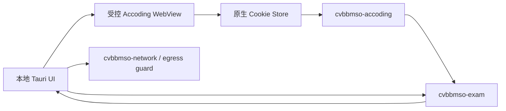

# cvbbmso-client — Tauri 桌面客户端

本 crate 是 Windows/macOS 可执行程序。使用 Tauri 2 承载受控 OJ WebView、登录界面、考试选择与只读考试状态；应用启动预检、系统出站守卫、联网与录像由本 crate 与 [cvbbmso-exam](cvbbmso-exam.md) 编排。

## 桌面底座

当前底座可在 Windows 和 macOS 启动本地控制窗，并通过独立窗口打开 Accoding 登录页。用 `cargo run --release --locked -p cvbbmso-client` 启动。底座提供 `open_accoding`、`inspect_session` 和 `list_exams` 三个本地命令。关闭控制窗将退出应用，同时关闭 Accoding 窗口。`inspect_session` 将 Cookie 是否可用定向通知本地 UI。加载报名列表时由监考服务复验 Accoding 身份。

部署时可在编译环境中设置 `CVBBMSO_SERVER_ORIGIN`，例如 `https://monitor.example.org`。该值须为 HTTPS Origin，可含端口。显式配置无效地址（含空字符串）会导致启动失败。未设置该变量时，控制窗可照常启动，加载报名列表会提示未配置监考服务地址。远程页面和前端命令均无法设置请求目的地。应用数据根目录通过 Tauri 的 `app_local_data_dir()` 取得。Windows 的 Accoding WebView 用该目录下的 `accoding/` 保存浏览器配置，macOS 使用系统管理的应用 WebKit 数据存储。

关闭 Accoding 窗口会暂时隐藏它。再次点击「打开 Accoding」会恢复原页面和会话。退出应用后的 Cookie 保留遵循站点设置的有效期和 WebView 的存储规则。

同源弹窗链接在现有 Accoding 窗口打开。客户端根据身份接口 URL 读取原生 Cookie Store，并保留适用的 HttpOnly 会话和附加 Cookie。界面只显示是否读取到会话，Cookie 原值仅供 Rust 使用。

运行 `cargo test --release --locked -p cvbbmso-client --bin cvbbmso-client -- --native-smoke` 可在交互式桌面验证两类 WebView 的权限隔离、导航、Release 调试设置、合成 Cookie 更新以及关闭并重新打开 Accoding 窗口后的会话保留。该测试也会打开真实 Accoding 登录页，无需登录。协议替身绑定回环地址，以临时 TLS 证书和合成凭据验证 HTTPS 接口、WSS 握手及首帧。

## 应用接口

本 crate 是二进制入口，公开契约是 Tauri commands。Tauri 本地命令面向可信的本地应用 UI；Accoding 远程网页使用普通 WebView 权限。

| Tauri command | 入参 | 返回数据 | 语义 |
| --- | --- | --- | --- |
| `list_exams` | 无 | `ExamSummary[]` | 使用当前 Cookie 调用 `GET /api/exams` |
| `open_exam` | `{ exam_id: uuid }` | `{ "connected": true }` | 调用 `Exam::connect`；等待初始 `sync` 后返回。网络、出站守卫和权限预检已在启动时完成 |
| `get_exam_status` | 无 | `ClientView` 或 `null` | 读取当前考试状态快照 |
| `close_exam` | 无 | `{ "closed": true }` | 停止当前考试运行时，封存当前录像片段并释放考试 |
| `cvbbmso-status` 事件 | 无 | `ClientView` | 考试运行时主动更新状态 |

```rust
// 本 crate 的内部组装对象，crate 私有。
struct AppState { /* 浏览器、活动 ExamHandle */ }

enum AppError {
    Auth,
    Network,
    Exam(cvbbmso_exam::ExamError),
    Io,
}

impl AppState {
    /// 读取学生站的原生 Cookie，并列出已报名考试。
    async fn list_exams(&self) -> Result<Vec<ExamSummary>, AppError>;

    /// 启动预检通过后建立考试运行时；同时承载一场活动考试。
    async fn open_exam(&self, exam_id: Uuid) -> Result<(), AppError>;

    /// 返回最近一次考试状态快照。
    fn get_exam_status(&self) -> Option<ClientView>;

    /// 停止当前考试运行时；当前片段被停止并封存。
    async fn close_exam(&self) -> Result<(), AppError>;
}
```

`AppState` 和浏览器适配器保留为 crate 私有类型；上表 Tauri command 是客户端 UI 的实际契约，`ClientView` 由 `cvbbmso-exam` 定义。`open_exam` 等待初始 `sync` 后返回 `connected`，失败时直接返回错误；`close_exam` 是切换考试或退出前的收尾入口，负责停止并封存当前片段。启动预检和出站守卫错误归入 `AppError::Network`。

## 启动预检、出站守卫与屏幕权限

应用启动时、以及预检失败后用户重试进入考试时，客户端执行一次启动流程：

1. 检查当前进程是否具备管理员/root 权限。系统级出站守卫需要特权；无法取得权限时，客户端停留在考试外并展示提权指引。
2. 调用 `cvbbmso-network::Inspector::check`。只有 `proxy = clear` 且 `endpoint = reachable` 才允许进入考试。检测到代理、代理状态未知、服务端不可达或检查失败时，客户端停留在考试外并展示对应错误，等待用户重试。
3. 调用 `cvbbmso-network::EgressGuard::install`，传入 Accoding Origin 和监考服务器 Origin。守卫保持到应用退出，期间系统只放行允许的出站流量。安装失败时同样停留在考试外。
4. macOS 上由本 crate 的平台适配层探测屏幕录制权限；未授权时发起系统授权请求。仍无权限或授权后需要重启应用时，展示明确指引并阻止进入考试。Windows 视为已授权。

屏幕权限探测与申请由 binary crate 内部实现，发生在应用启动流程中；未通过时 UI 展示阻断提示。`open_exam` 在启动流程全部通过后调用 `Exam::connect`。网络预检在应用启动和用户重试进入考试时执行，出站守卫在此时安装并保持到应用退出；`close_exam` 只释放考试运行时，应用退出时调用 `shutdown`。客户端每 30 秒调用 `EgressGuard::verify`；运行期校验失败时停止考试并提示用户。

## 受控浏览器规范

固定允许的网页 Origin 为 `https://accoding.buaa.edu.cn`。保留正常浏览器中的 Accoding 登录、题目、编辑、输入法、剪贴板与提交功能；主框架导航、弹窗和重定向限定同 Origin。客户端提供精简窗口：地址栏、自由标签页和外部协议入口关闭；Release 模式保持开发者工具与调试快捷键关闭。

Windows 基于 WebView2 配置 `AreDevToolsEnabled=false`、`AreBrowserAcceleratorKeysEnabled=false`；macOS 基于 WKWebView 配置 `isInspectable=false`。资源访问限制由 WebView 平台适配与 OJ 的 CSP 协作，URL 校验以解析后的协议、主机和端口为准。剪贴板是保留的浏览器能力。

## Cookie 登录与考试连接

学生在 WebView 加载 `https://accoding.buaa.edu.cn/user/login`。浏览器完成 `GET /user/login`、带 `_csrf` 的表单 POST、跳转和 `Set-Cookie` 处理；Rust 原生代码从 WebView Cookie Store 取得 `connect.sid` 和可用的附加 Cookie，创建 `cvbbmso-accoding::AccodingCookies`。

每次加载或刷新报名列表，`list_exams` 都从原生 Cookie Store 读取当前会话。Rust 仅向构建时配置的 HTTPS Origin 发送 `GET /api/exams`，禁用重定向和代理。HTTP 200 的响应体上限为 1 MiB（1,048,576 字节）。客户端在读取时累计正文实际字节数，超限立即停止读取，无 `Content-Length` 的分块响应也受此限制。成功响应必须是包含 `user` 和 `items` 的 JSON 对象，由 `ExamListResponse` 校验，只把 `items` 返回本地控制窗。HTTP 200 且列表为空表示用户已登录但未报名。HTTP 401 提示重新登录，HTTP 503 提示稍后重试。刷新时清空旧列表，响应超限、格式无效或请求失败时显示相应错误。

学生选择考试后生成当前进程 `instance_id` 并调用 `Exam::connect(config, exam_id, cookies)`；运行时重新拉取 `user` 并校验报名，再连接 `GET /api/exams/{exam_id}/ws`。Cookie 变化通过 `ExamHandle::notify(UiNotice::CookiesUpdated(...))` 传给运行时，用于后续重连；受控浏览器拒绝导航时，通过 `ExamHandle::notify(UiNotice::NavigationDenied { target_origin })` 通知运行时。

## 模块协作



考试开始和结束由 WebSocket 服务端指令驱动；本地 UI 负责展示 `ClientView`，包括当前考试、连接状态、录屏状态及错误码。一个进程同时承载一场活动考试；切换考试前必须调用 `close_exam`。
