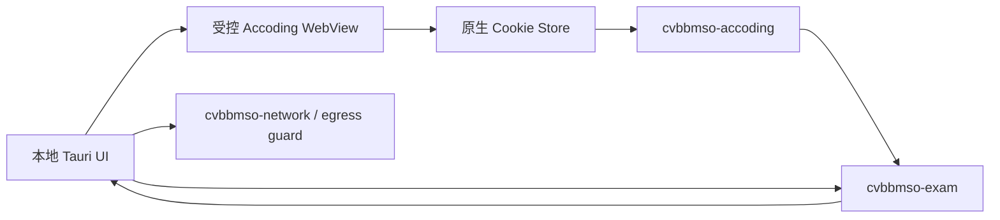

# cvbbmso-client — Tauri 桌面客户端

本 crate 是 Windows/macOS 可执行程序。使用 Tauri 2 承载受控 OJ WebView、登录界面、考试选择与只读考试状态；应用启动预检、系统出站守卫、联网与录像由本 crate 与 [cvbbmso-exam](cvbbmso-exam.md) 编排。

## 桌面底座

当前底座可在 Windows 和 macOS 启动本地控制窗，并通过独立窗口打开 Accoding 登录页。用 `cargo run --release --locked -p cvbbmso-client` 启动。虚拟机预检通过后，控制窗可调用 `open_accoding`、`inspect_session` 和 `list_exams`。关闭控制窗将退出应用，同时关闭 Accoding 窗口。`inspect_session` 将 Cookie 是否可用定向通知本地 UI。加载报名列表时由监考服务复验 Accoding 身份。

部署时可在编译环境中设置 `CVBBMSO_SERVER_ORIGIN`，例如 `https://monitor.example.org`。该值须为 HTTPS Origin，可含端口。显式配置无效地址（含空字符串）会导致启动失败。未设置该变量时，控制窗可照常启动，加载报名列表会提示未配置监考服务地址。远程页面和前端命令均无法设置请求目的地。应用数据根目录通过 Tauri 的 `app_local_data_dir()` 取得。Windows 的 Accoding WebView 用该目录下的 `accoding/` 保存浏览器配置，macOS 使用系统管理的应用 WebKit 数据存储。

关闭 Accoding 窗口会暂时隐藏它。再次点击「打开 Accoding」会恢复原页面和会话。退出应用后的 Cookie 保留遵循站点设置的有效期和 WebView 的存储规则。

同源弹窗链接在现有 Accoding 窗口打开。客户端根据身份接口 URL 读取原生 Cookie Store，并保留适用的 HttpOnly 会话和附加 Cookie。界面只显示是否读取到会话，Cookie 原值仅供 Rust 使用。

运行 `cargo test --release --locked -p cvbbmso-client --bin cvbbmso-client -- --native-smoke` 可在交互式桌面验证预检失败后的重试、两类 WebView 的权限隔离、导航、Release 调试设置、合成 Cookie 更新以及关闭并重新打开 Accoding 窗口后的会话保留。该测试也会打开真实 Accoding 登录页，无需登录。将末尾参数换为 `--native-smoke-detected` 可验证检测到虚拟机后的本地阻断与退出。两组冒烟都验证直接调用受限命令不会创建远程 WebView 或外发请求。协议替身绑定回环地址，以临时 TLS 证书和合成凭据验证 HTTPS 接口、WSS 握手及首帧。

将末尾参数换为 `--native-exam-smoke`，可用回环 HTTPS/WSS 服务和合成 Cookie 验证实际考试运行时的入场、重登、断线恢复、导航事件和关闭。测试子进程使用临时证书，不修改系统信任库。测试中的准入替身仅编译到测试程序。

## 应用接口

本 crate 是二进制入口，公开契约是 Tauri commands。Tauri 本地命令面向可信的本地应用 UI；Accoding 远程网页使用普通 WebView 权限。

| Tauri command | 入参 | 返回数据 | 语义 |
| --- | --- | --- | --- |
| `vm_preflight` | `{ retry: bool }` | `{ status, reason }` | 读取设备检查结果。仅在上次结果为 `unknown` 时响应重试 |
| `admission_status` | `{ retry: bool }` | `{ status, reason? }` | 读取正式准入状态，或重试可恢复的失败。仅本地控制窗可调用 |
| `admission-status` 事件 | 无 | `{ status, reason? }` | 定向通知本地控制窗正式准入状态变化 |
| `list_exams` | 无 | `ExamSummary[]` | 使用当前 Cookie 调用 `GET /api/exams` |
| `open_exam` | `{ exam_id: uuid }` | `{ "connected": true }` | 调用 `Exam::connect`；等待初始 `sync` 后返回。网络、出站守卫和权限预检已在启动时完成 |
| `get_exam_status` | 无 | `ClientView` 或 `null` | 读取当前考试状态快照 |
| `close_exam` | 无 | `{ "closed": true }` | 停止当前考试运行时，封存当前录像片段并释放考试 |
| `cvbbmso-status` 事件 | 无 | `ClientView` | 考试运行时主动更新状态 |

```rust
// 本 crate 的内部组装对象，crate 私有。
struct AppState { /* 浏览器、活动 ExamHandle */ }

enum AppError {
    Auth,
    Network,
    Exam(cvbbmso_exam::ExamError),
    Io,
}

impl AppState {
    /// 读取学生站的原生 Cookie，并列出已报名考试。
    async fn list_exams(&self) -> Result<Vec<ExamSummary>, AppError>;

    /// 启动预检通过后建立考试运行时；同时承载一场活动考试。
    async fn open_exam(&self, exam_id: Uuid) -> Result<(), AppError>;

    /// 返回最近一次考试状态快照。
    fn get_exam_status(&self) -> Option<ClientView>;

    /// 停止当前考试运行时；当前片段被停止并封存。
    async fn close_exam(&self) -> Result<(), AppError>;
}
```

`AppState` 和浏览器适配器保留为 crate 私有类型；上表 Tauri command 是客户端 UI 的实际契约，`ClientView` 由 `cvbbmso-exam` 定义。`open_exam` 等待初始 `sync` 后返回 `connected`，失败时直接返回错误；`close_exam` 是切换考试或退出前的收尾入口，负责停止并封存当前片段。启动预检和出站守卫错误归入 `AppError::Network`。

连接期间 `get_exam_status` 返回 `null`，重复入场或同时打开另一场考试返回 `session_busy`。关闭时停止发送当前会话的状态，等待运行时收尾后释放会话。状态事件定向发送到本地控制窗。控制窗收到事件后读取 Rust 中的当前快照，避免延迟到达的旧事件覆盖新状态。

## 启动预检、出站守卫与屏幕权限

应用启动时、以及预检失败后用户重试进入考试时，客户端执行一次启动流程：

1. 在 Rust 中执行虚拟机预检。只有 `NotDetected` 放行。其余结果阻断 Accoding 窗口、会话检查、报名列表请求和进入考试。
2. 检查当前进程是否具备管理员/root 权限。系统级出站守卫需要特权。无法取得权限时，客户端停留在考试外并展示提权指引。
3. 调用 `cvbbmso-network::Inspector::check`。只有 `proxy = clear` 且 `endpoint = reachable` 才允许进入考试。检测到代理、代理状态未知、服务端不可达或检查失败时，客户端停留在考试外并展示对应错误，等待用户重试。
4. 调用 `cvbbmso-network::EgressGuard::install`，传入 Accoding Origin 和监考服务器 Origin。守卫保持到应用退出，期间系统只放行允许的出站流量。安装失败时同样停留在考试外。
5. macOS 上由本 crate 的平台适配层探测屏幕录制权限，未授权时发起系统授权请求。仍无权限或授权后需要重启应用时，展示明确指引并阻止进入考试。Windows 视为已授权。

虚拟机检查通过后，Rust 启动其余准入步骤。只有 `admission_status` 返回 `ready` 时才开放登录窗口、会话检查、报名列表和考试入场。控制窗可重试代理、可达性、守卫安装和屏幕权限失败。管理员权限、部署配置、录屏权限要求重启或运行期守卫失效时，界面显示对应的操作指引。

出站守卫归应用所有。录屏权限失败后的重试复用已安装的守卫，单次检查期间的并发重试共用同一次启动流程。客户端每 30 秒校验守卫。运行期校验失败时，Rust 阻止新入场并结束活动考试，用户需要退出后重新启动。退出会等待正在安装的守卫返回，并在考试运行时收尾后撤销守卫。正常退出一场考试不撤销守卫。

Release 桌面冒烟使用测试替身验证准入重试和守卫失效。`--native-admission-exit` 验证安装尚未返回时退出的顺序。真实 PF、WFP 和特权部署在隔离环境中验收。

### 虚拟机预检

- Windows 通过系统自带的本地 CIM 查询读取 `Win32_ComputerSystem` 的厂商和型号。首版识别 Hyper-V、VMware、VirtualBox、Parallels（含 Windows ARM）以及 QEMU/KVM 的已知厂商和型号组合。厂商和型号冲突，或已识别为虚拟化厂商但型号无法核对时，返回 `Unknown`。`HypervisorPresent` 只记录辅助诊断，启用 Hyper-V、VBS 或内存完整性的实体机可在硬件信息通过核验后正常使用。[Windows CIM 字段](https://learn.microsoft.com/en-us/windows/win32/cimwin32prov/win32-computersystem) · [Parallels ARM 来宾设备报告](https://learn.microsoft.com/en-us/answers/questions/5181595/i-am-unable-to-activate-office-365-arm-on-windows?page=6)
- 主板固件可能为实体机提供 `System manufacturer`、`System Product Name` 等占位值。首版对无法核验的占位值显示 `Unknown` 和联系考试管理员的指引。验证补充信号时，可只读采集 `Win32_BaseBoard` 的厂商和产品型号，并与实体机产品资料及虚拟主板样本交叉核对。主板字段也来自 SMBIOS，需在带占位值的实体机与来宾上完成对照后才能作为准入证据。[ASUS 硬件管理手册](https://dlcdnets.asus.com/pub/ASUS/mb/14Utilities/ASUS_Control_Center_Express_EM_WEB.pdf) · [Windows 主板字段](https://learn.microsoft.com/en-us/windows/win32/cimwin32prov/win32-baseboard)
- macOS 读取 `hw.model` 和 `kern.hv_vmm_present`。`VirtualMac` 系列型号与内核客户机标志一致时判为 `Detected`。识别为实体 Mac 型号且内核客户机标志为 0 时判为 `NotDetected`。结果不一致、关键值缺失或无法识别时返回 `Unknown`。该检查不使用宿主机虚拟化能力、图形渲染模式或 WebGL。
- 查询只读。macOS 最长等待 5 秒。Windows 的 15 秒上限涵盖系统进程启动、CIM 加载及查询。关键读取失败、超时或证据冲突的诊断仅在本地保留预定义类别，内容不含设备序列号或唯一标识。`Detected` 显示阻断信息及退出入口。`Unknown` 显示原因和重试入口。初次结果返回前也禁止使用受限命令。
- 新增本地命令 `vm_preflight`，输入 `{ retry: bool }`，返回 `{ status, reason }`，供控制窗显示状态。显式重试只在 `Unknown` 后重新读取系统信息。现有命令的名称、入参和成功载荷保持原契约。阻断时，`open_accoding` 和 `inspect_session` 返回本地提示，`list_exams` 返回 `preflight_blocked`。
- 托管运行器的桌面冒烟仅在测试构建中使用预设结果。换用测试参数 `--native-vm-probe` 可记录当前系统原生探测的结果。部署验收还需记录实际 Windows 实体机（启用内存完整性）、Windows 虚拟机、Apple silicon 实体 Mac 和 Apple silicon macOS 虚拟机的系统版本及适用的虚拟机产品。

屏幕权限探测与申请由 binary crate 内部实现，发生在应用启动流程中；未通过时 UI 展示阻断提示。`open_exam` 在启动流程全部通过后调用 `Exam::connect`。网络预检在应用启动和用户重试进入考试时执行，出站守卫在此时安装并保持到应用退出；`close_exam` 只释放考试运行时，应用退出时调用 `shutdown`。客户端每 30 秒调用 `EgressGuard::verify`；运行期校验失败时停止考试并提示用户。

## 受控浏览器规范

固定允许的网页 Origin 为 `https://accoding.buaa.edu.cn`。保留正常浏览器中的 Accoding 登录、题目、编辑、输入法、剪贴板与提交功能；主框架导航、弹窗和重定向限定同 Origin。客户端提供精简窗口：地址栏、自由标签页和外部协议入口关闭；Release 模式保持开发者工具与调试快捷键关闭。

Windows 基于 WebView2 配置 `AreDevToolsEnabled=false`、`AreBrowserAcceleratorKeysEnabled=false`；macOS 基于 WKWebView 配置 `isInspectable=false`。资源访问限制由 WebView 平台适配与 OJ 的 CSP 协作，URL 校验以解析后的协议、主机和端口为准。剪贴板是保留的浏览器能力。

## Cookie 登录与考试连接

学生在 WebView 加载 `https://accoding.buaa.edu.cn/user/login`。浏览器完成 `GET /user/login`、带 `_csrf` 的表单 POST、跳转和 `Set-Cookie` 处理；Rust 原生代码从 WebView Cookie Store 取得 `connect.sid` 和可用的附加 Cookie，创建 `cvbbmso-accoding::AccodingCookies`。

每次加载或刷新报名列表，`list_exams` 都从原生 Cookie Store 读取当前会话。Rust 仅向构建时配置的 HTTPS Origin 发送 `GET /api/exams`，禁用重定向和代理。HTTP 200 的响应体上限为 1 MiB（1,048,576 字节）。客户端在读取时累计正文实际字节数，超限立即停止读取，无 `Content-Length` 的分块响应也受此限制。成功响应必须是包含 `user` 和 `items` 的 JSON 对象，由 `ExamListResponse` 校验，只把 `items` 返回本地控制窗。HTTP 200 且列表为空表示用户已登录但未报名。HTTP 401 提示重新登录，HTTP 503 提示稍后重试。刷新时清空旧列表，响应超限、格式无效或请求失败时显示相应错误。

客户端在首次入场时将 `device_id` 持久化到应用数据根目录，后续入场读取同一标识。`instance_id` 在进程启动时生成，同一进程内的重连和重新入场都沿用它。准入通过后，Rust 读取原生 Cookie 并调用 `Exam::connect(config, exam_id, cookies)`，由运行时重新获取 `user` 并校验报名，再连接 `GET /api/exams/{exam_id}/ws`。

活动考试期间，Rust 间隔两秒读取原生 Cookie Store，通过 `UiNotice::CookiesUpdated` 提交有效的变化。读取失败或暂时没有会话时保留上次结果，自动采样只在 Cookie 变化时触发复验。监考服务短时无法复验时，学生可点击「检查会话」，用浏览器里的当前 Cookie 重试。运行时核对考生身份，采用同一考生的新 Cookie 后恢复连接。控制窗根据 `ClientView` 提示重连，在 `ACCODING_AUTH_EXPIRED` 时提供重新登录入口。学生点击后，控制窗在受控 Accoding 窗口打开登录页。

受控窗口拒绝跨源导航或弹窗时，向活动运行时非阻塞地提交 `UiNotice::NavigationDenied`。通知只携带可解析的目标 Origin。关闭或结束考试会丢弃该场考试待提交的浏览器通知，后续考试使用自己的通知队列。

## 模块协作



考试开始和结束由 WebSocket 服务端指令驱动；本地 UI 负责展示 `ClientView`，包括当前考试、连接状态、录屏状态及错误码。一个进程同时承载一场活动考试；切换考试前必须调用 `close_exam`。
