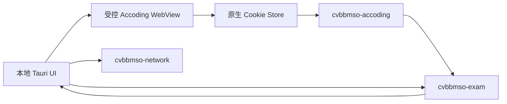

# cvbbmso-client — Tauri 桌面客户端

本 crate 是 Windows/macOS 可执行程序。使用 Tauri 2 承载受控 OJ WebView、登录界面、考试选择与只读考试状态；应用启动预检、联网与录像由本 crate 与 [cvbbmso-exam](cvbbmso-exam.md) 编排。

## 应用接口

本 crate 是二进制入口，公开契约是 Tauri commands。Tauri 本地命令面向可信的本地应用 UI；Accoding 远程网页使用普通 WebView 权限。

| Tauri command | 入参 | 返回数据 | 语义 |
| --- | --- | --- | --- |
| `list_exams` | 无 | `ExamSummary[]` | 使用当前 Cookie 调用 `GET /api/exams` |
| `open_exam` | `{ exam_id: uuid }` | `{ "connected": true }` | 调用 `Exam::connect`；等待初始 `sync` 后返回。网络与权限预检已在启动时完成 |
| `get_exam_status` | 无 | `ClientView` 或 `null` | 读取当前考试状态快照 |
| `close_exam` | 无 | `{ "closed": true }` | 停止当前考试运行时，封存当前录像片段并释放考试 |
| `cvbbmso-status` 事件 | 无 | `ClientView` | 考试运行时主动更新状态 |

```rust
// 本 crate 的内部组装对象，crate 私有。
struct AppState { /* 浏览器、活动 ExamHandle */ }

enum AppError {
    Auth,
    Network,
    Exam(cvbbmso_exam::ExamError),
    Io,
}

impl AppState {
    /// 读取学生站的原生 Cookie，并列出已报名考试。
    async fn list_exams(&self) -> Result<Vec<ExamSummary>, AppError>;

    /// 启动预检通过后建立考试运行时；同时承载一场活动考试。
    async fn open_exam(&self, exam_id: Uuid) -> Result<(), AppError>;

    /// 返回最近一次考试状态快照。
    fn get_exam_status(&self) -> Option<ClientView>;

    /// 停止当前考试运行时；当前片段被停止并封存。
    async fn close_exam(&self) -> Result<(), AppError>;
}
```

`AppState` 和浏览器适配器保留为 crate 私有类型；上表 Tauri command 是客户端 UI 的实际契约，`ClientView` 由 `cvbbmso-exam` 定义。`open_exam` 等待初始 `sync` 后返回 `connected`，失败时直接返回错误；`close_exam` 是切换考试或退出前的收尾入口，负责停止并封存当前片段。

## 启动预检与屏幕权限

应用启动时、以及预检失败后用户重试进入考试时，客户端执行一次预检：

1. 调用 `cvbbmso-network::Inspector::check`。只有 `proxy = clear` 且 `endpoint = reachable` 才允许进入考试。检测到代理、代理状态未知、服务端不可达或检查失败时，客户端停留在考试外并展示对应错误，等待用户重试。
2. macOS 上由本 crate 的平台适配层探测屏幕录制权限；未授权时发起系统授权请求。仍无权限或授权后需要重启应用时，展示明确指引并阻止进入考试。Windows 视为已授权。

屏幕权限探测与申请由 binary crate 内部实现，发生在应用启动流程中；未通过时 UI 展示阻断提示。`open_exam` 在预检通过后调用 `Exam::connect`。网络预检在应用启动和用户重试进入考试时执行。

## 受控浏览器规范

固定允许的网页 Origin 为 `https://accoding.buaa.edu.cn`。保留正常浏览器中的 Accoding 登录、题目、编辑、输入法、剪贴板与提交功能；主框架导航、弹窗和重定向限定同 Origin。客户端提供精简窗口：地址栏、自由标签页和外部协议入口关闭；Release 模式保持开发者工具与调试快捷键关闭。

Windows 基于 WebView2 配置 `AreDevToolsEnabled=false`、`AreBrowserAcceleratorKeysEnabled=false`；macOS 基于 WKWebView 配置 `isInspectable=false`。资源访问限制由 WebView 平台适配与 OJ 的 CSP 协作，URL 校验以解析后的协议、主机和端口为准。剪贴板是保留的浏览器能力。

## Cookie 登录与考试连接

学生在 WebView 加载 `https://accoding.buaa.edu.cn/user/login`。浏览器完成 `GET /user/login`、带 `_csrf` 的表单 POST、跳转和 `Set-Cookie` 处理；Rust 原生代码从 WebView Cookie Store 取得 `connect.sid` 和可用的附加 Cookie，创建 `cvbbmso-accoding::AccodingCookies`。

登录完成后，客户端以 Cookie 请求监考服务器 `GET /api/exams`，`list_exams` 展示返回的 `items`。学生选择考试后生成当前进程 `instance_id` 并调用 `Exam::connect(config, exam_id, cookies)`；运行时重新拉取 `user` 并校验报名，再连接 `GET /api/exams/{exam_id}/ws`。Cookie 变化通过 `ExamHandle::notify(UiNotice::CookiesUpdated(...))` 传给运行时，用于后续重连；受控浏览器拒绝导航时，通过 `ExamHandle::notify(UiNotice::NavigationDenied { target_origin })` 通知运行时。

## 模块协作



考试开始和结束由 WebSocket 服务端指令驱动；本地 UI 负责展示 `ClientView`，包括当前考试、连接状态、录屏状态及错误码。一个进程同时承载一场活动考试；切换考试前必须调用 `close_exam`。
