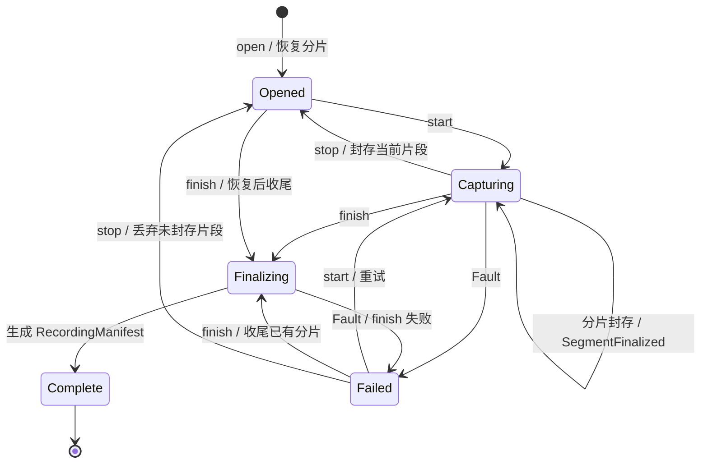

# cvbbmso-recorder — 屏幕录制与录像摘要

本 crate 管理 Windows/macOS 主显示器录屏、分片落盘、异常恢复、合并和 SHA-256 计算。Windows 采用 Desktop Duplication，macOS 采用 ScreenCaptureKit；视频采用 H.264，分片封装为 MKV，最终产物为 MP4。录屏范围为主显示器，音频关闭，文件保留在本地。

编码、容器和系统桥接均为私有实现；本文档定义公开接口、本地文件约定和故障行为。屏幕权限的探测与申请属于 [cvbbmso-client](cvbbmso-client.md)；权限在运行中被撤销时表现为采集故障。

## 公开 Rust API

```rust
use tokio::sync::mpsc::Receiver;

pub struct Recorder { /* 私有录制状态 */ }

pub enum RecorderEvent {
    SegmentFinalized(cvbbmso_protocol::SegmentMeta),
    Fault(RecordingError),
}

pub enum RecordingError {
    Io(std::io::Error),
    Platform(PlatformError),
    Encoder(EncoderError),
    NoSegments,
    Merge(MergeError),
}

impl Recorder {
    /// 打开考生录像目录并恢复已封存分片。
    /// 返回的接收端从 open 起即可接收恢复分片事件。
    pub async fn open(
        exam_id: uuid::Uuid,
        oj_user_id: i64,
        candidate_dir: std::path::PathBuf,
        policy: cvbbmso_protocol::RecordingPolicy,
    ) -> Result<(Self, Receiver<RecorderEvent>), RecordingError>;

    /// 开始或恢复主显示器录制；已处于采集状态时幂等。
    pub async fn start(&mut self) -> Result<(), RecordingError>;

    /// 停止采集并封存当前片段；合并与 manifest 由 finish 负责。
    /// 已停止或未在采集时幂等；在 Failed 状态调用只丢弃当前未封存片段，已封存分片保留。
    pub async fn stop(&mut self) -> Result<(), RecordingError>;

    /// 停止采集、封存剩余片段、合并视频并返回完整摘要。
    /// 已完成后重复调用返回同一 manifest；分片清单为空时返回 NoSegments。
    pub async fn finish(
        &mut self,
    ) -> Result<cvbbmso_protocol::RecordingManifest, RecordingError>;
}
```

`RecordingError` 的 `Io` / `Platform` / `Encoder` / `Merge` 变体携带底层原因（`std::io::Error`、`PlatformError`、`EncoderError`、`MergeError`），使应用层通过 `anyhow` 输出完整 source 链。`PlatformError`、`EncoderError`、`MergeError` 是本 crate 的错误类型，均为 `#[non_exhaustive]`，随采集、编码和合并的实现扩充变体；`NoSegments` 是状态判定，不携带原因。

`candidate_dir` 是考生目录 `<app-data>/exams/<exam-id>/<oj-user-id>/`，由运行时传入；`Recorder` 在其中创建 `recording/`。`open` 读取并恢复已封存分片，恢复分片按 `index` 升序通过接收端发送 `SegmentFinalized`。运行时为这些分片复用本地持久化的原 `event.seq`，因此 `open` 可以安全地重复发出全部分片。

`start` 由运行时在收到 `start_exam` 后调用；`stop` 由主动关闭或 `end_at + 60s` 本地截止调用；`finish` 由 `end_exam` 触发。`RecorderEvent::SegmentFinalized` 在分片文件和元信息保存完成后发送；`Fault` 仅表示采集、编码或写盘失败，运行时将其转换为 `recording_failed` 异常并重试。`NoSegments`、`Merge` 由 `finish` 作为错误返回。WebSocket、事件序号和异常记录由运行时负责。

## 文件与分片元信息

```text
<app-data>/exams/<exam-id>/<oj-user-id>/recording/
├── segments/
│   ├── 000001.mkv
│   ├── 000001.json
│   ├── 000002.mkv
│   └── 000002.json
└── final.mp4
```

分片元信息由 [cvbbmso-protocol](cvbbmso-protocol.md) 的 `SegmentMeta` 定义，`index` 从 1 开始并与文件名序号一致：

```json
{
  "index": 1,
  "start_at": "2026-12-20T01:00:00Z",
  "end_at": "2026-12-20T01:00:30Z",
  "sha256": "aaaaaaaaaaaaaaaaaaaaaaaaaaaaaaaaaaaaaaaaaaaaaaaaaaaaaaaaaaaaaaaa"
}
```

`start_at` / `end_at` 是该片段实际录制的起止 UTC 时间；`sha256` 是 `NNNNNN.mkv` 封存后整个文件的 SHA-256。`RecordingManifest` 按 `index` 升序列出所有片段，索引从 1 连续递增且清单非空，并携带合并后 `final.mp4` 整个文件的 `merged_sha256`。

```json
{
  "segments": [{
    "index": 1,
    "start_at": "2026-12-20T01:00:00Z",
    "end_at": "2026-12-20T01:00:30Z",
    "sha256": "aaaaaaaaaaaaaaaaaaaaaaaaaaaaaaaaaaaaaaaaaaaaaaaaaaaaaaaaaaaaaaaa"
  }],
  "merged_sha256": "bbbbbbbbbbbbbbbbbbbbbbbbbbbbbbbbbbbbbbbbbbbbbbbbbbbbbbbbbbbbbbbb"
}
```

`final.mp4` 在 `finish` 过程中生成，失败时可能留下半成品。重新 `finish` 或下次 `open` 会清理或重建该文件，以完整文件作为合法 manifest 的产物。

## 录像生命周期



- `Failed` 可通过 `start` 重试或通过 `finish` 收尾。采集故障后运行时先上报 `recording_failed`，再调用 `start` 重试；成功后进入 `Capturing` 并上报 `recording_recovered`。重试由运行时控制，recorder 负责单次尝试。
- `finish` 是单次尝试。失败后状态为 `Failed`，允许再次 `finish`；运行时按有界退避重试。已 `Complete` 后重复 `finish` 返回同一 manifest。
- `finish` 可从 `Opened` 或 `Failed` 调用，用于考试结束或恢复后的收尾；分片清单为空时返回 `NoSegments`。
- `stop` 封存当前片段；合并与 manifest 由 `finish` 负责。主动关闭或 `end_at + 60s` 本地截止使用它；之后仍可通过 `finish` 生成摘要。
- 客户端异常退出后，`open` 检索既有分片并恢复可用录制状态；考试仍在进行时由运行时在收到新的 `start_exam` 后调用 `start` 继续录制。
- 考试已结束时，服务端下发 `end_exam`，由 `finish` 收尾现有录像；`recording_finalized` 事件仅在分片清单非空时生成。
- 录像形成的分片和最终摘要通过 `cvbbmso-exam` 转为 [协议](cvbbmso-protocol.md) 中的可靠 `event` 消息。
