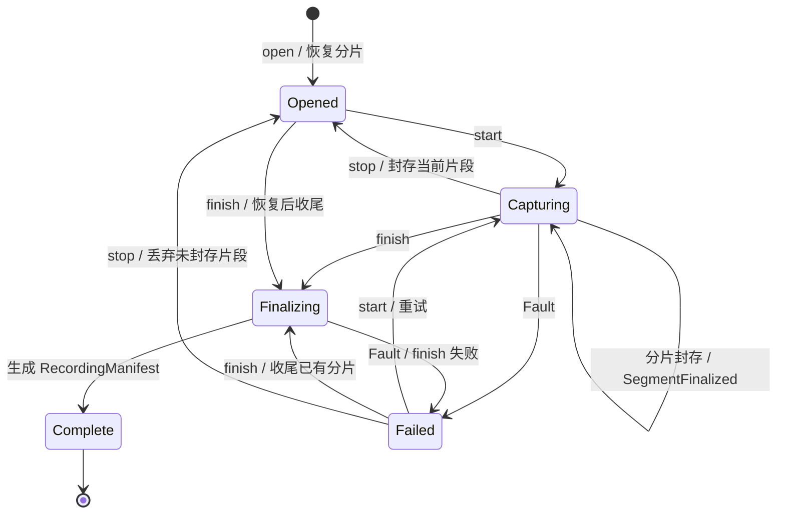

# cvbbmso-recorder — 屏幕录制与录像摘要

本 crate 管理 Windows/macOS 主显示器录屏、分片落盘、异常恢复、合并和 SHA-256 计算。Windows 采用 Desktop Duplication，macOS 采用 ScreenCaptureKit；视频采用 H.264，分片封装为 MKV，最终产物为 MP4。录屏范围为主显示器，音频关闭，文件保留在本地。

编码、容器和系统桥接均为私有实现；本文档定义公开接口、本地文件约定和故障行为。屏幕权限的探测与申请属于 [cvbbmso-client](cvbbmso-client.md)；权限在运行中被撤销时表现为采集故障。

## 公开 Rust API

```rust
use tokio::sync::mpsc::Receiver;

pub struct Recorder { /* 私有录制状态 */ }

pub enum RecorderEvent {
    SegmentFinalized(cvbbmso_protocol::SegmentMeta),
    Fault(RecordingError),
}

pub enum RecordingError {
    Io(std::io::Error),
    Platform(Option<std::io::Error>),
    Encoder(Option<std::io::Error>),
    NoSegments,
    Merge(Option<std::io::Error>),
}

impl Recorder {
    /// 打开考生录像目录并恢复已封存分片。
    /// 返回的接收端从 open 起即可接收恢复分片事件。
    pub async fn open(
        exam_id: uuid::Uuid,
        oj_user_id: i64,
        candidate_dir: std::path::PathBuf,
        policy: cvbbmso_protocol::RecordingPolicy,
    ) -> Result<(Self, Receiver<RecorderEvent>), RecordingError>;

    /// 开始或恢复主显示器录制；已处于采集状态时幂等。
    pub async fn start(&mut self) -> Result<(), RecordingError>;

    /// 停止采集并封存当前片段；合并与 manifest 由 finish 负责。
    /// 已停止或未在采集时幂等；在 Failed 状态调用只丢弃当前未封存片段，已封存分片保留。
    pub async fn stop(&mut self) -> Result<(), RecordingError>;

    /// 停止采集、封存剩余片段、合并视频并返回完整摘要。
    /// 已完成后重复调用返回同一 manifest；分片清单为空时返回 NoSegments。
    pub async fn finish(
        &mut self,
    ) -> Result<cvbbmso_protocol::RecordingManifest, RecordingError>;
}
```

`RecordingError` 是本 crate 唯一的公开错误类型，平台、编码和合并失败都是它的变体，而不是各自独立的枚举。`Io` 携带 `std::io::Error`；`Platform` 携带后端报出的错误，`None` 表示本平台没有采集后端；`Encoder` 携带编码器后端错误，`None` 表示本平台没有编码器；`Merge` 携带合并期间的文件或容器错误。`NoSegments` 是状态判定。来源通过 `#[source]` 保留，使应用层能用 `anyhow` 输出完整因果链。

Windows 后端将原始 `windows::core::Error` 对象放入 `std::io::Error`，不把它转换为字符串；平台适配层可以通过 `get_ref()` 取回原错误及 HRESULT，公开接口仍不暴露平台类型。

`candidate_dir` 是考生目录 `<app-data>/exams/<exam-id>/<oj-user-id>/`，由运行时传入；`Recorder` 在其中创建 `recording/`。`open` 读取并恢复已封存分片，恢复分片按 `index` 升序通过接收端发送 `SegmentFinalized`。运行时为这些分片复用本地持久化的原 `event.seq`，因此 `open` 可以安全地重复发出全部分片。

`start` 由运行时在收到 `start_exam` 后调用；`stop` 由主动关闭或 `end_at + 60s` 本地截止调用；`finish` 由 `end_exam` 触发。`RecorderEvent::SegmentFinalized` 在分片文件和元信息保存完成后发送；`Fault` 仅表示采集、编码或写盘失败，运行时将其转换为 `recording_failed` 异常并重试。`NoSegments`、`Merge` 由 `finish` 作为错误返回。WebSocket、事件序号和异常记录由运行时负责。

## 文件与分片元信息

```text
<app-data>/exams/<exam-id>/<oj-user-id>/recording/
├── segments/
│   ├── 000001.mkv
│   ├── 000001.json
│   ├── 000002.mkv
│   └── 000002.json
└── final.mp4
```

分片元信息由 [cvbbmso-protocol](cvbbmso-protocol.md) 的 `SegmentMeta` 定义，`index` 从 1 开始并与文件名序号一致：

```json
{
  "index": 1,
  "start_at": "2026-12-20T01:00:00Z",
  "end_at": "2026-12-20T01:00:30Z",
  "sha256": "aaaaaaaaaaaaaaaaaaaaaaaaaaaaaaaaaaaaaaaaaaaaaaaaaaaaaaaaaaaaaaaa"
}
```

`start_at` / `end_at` 是该片段实际录制的起止 UTC 时间；`sha256` 是 `NNNNNN.mkv` 封存后整个文件的 SHA-256。`RecordingManifest` 按 `index` 升序列出所有片段，索引从 1 连续递增且清单非空，并携带合并后 `final.mp4` 整个文件的 `merged_sha256`。

```json
{
  "segments": [{
    "index": 1,
    "start_at": "2026-12-20T01:00:00Z",
    "end_at": "2026-12-20T01:00:30Z",
    "sha256": "aaaaaaaaaaaaaaaaaaaaaaaaaaaaaaaaaaaaaaaaaaaaaaaaaaaaaaaaaaaaaaaa"
  }],
  "merged_sha256": "bbbbbbbbbbbbbbbbbbbbbbbbbbbbbbbbbbbbbbbbbbbbbbbbbbbbbbbbbbbbbbbb"
}
```

`final.mp4` 在 `finish` 过程中生成，失败时可能留下半成品。重新 `finish` 或下次 `open` 会清理或重建该文件，以完整文件作为合法 manifest 的产物。

## 录像生命周期



- `Failed` 可通过 `start` 重试或通过 `finish` 收尾。采集故障后运行时先上报 `recording_failed`，再调用 `start` 重试；成功后进入 `Capturing` 并上报 `recording_recovered`。重试由运行时控制，recorder 负责单次尝试。
- `finish` 是单次尝试。失败后状态为 `Failed`，允许再次 `finish`；运行时按有界退避重试。已 `Complete` 后重复 `finish` 返回同一 manifest。
- `finish` 可从 `Opened` 或 `Failed` 调用，用于考试结束或恢复后的收尾；分片清单为空时返回 `NoSegments`。
- `stop` 封存当前片段；合并与 manifest 由 `finish` 负责。主动关闭或 `end_at + 60s` 本地截止使用它；之后仍可通过 `finish` 生成摘要。
- 客户端异常退出后，`open` 检索既有分片并恢复可用录制状态；考试仍在进行时由运行时在收到新的 `start_exam` 后调用 `start` 继续录制。
- 考试已结束时，服务端下发 `end_exam`，由 `finish` 收尾现有录像；`recording_finalized` 事件仅在分片清单非空时生成。
- 录像形成的分片和最终摘要通过 `cvbbmso-exam` 转为 [协议](cvbbmso-protocol.md) 中的可靠 `event` 消息。

## M3 私有采样与原始帧验收

私有 `capture::run` 是同步的采样线程入口，由专用线程调用；后端在同一线程内创建、使用和销毁，以保持 COM 线程归属。它接收 `RecordingPolicy`、停止标志及同步帧消费者。编码器与 `Recorder::start/stop` 的流水线集成属于 M4/M5；本阶段通过独立硬件测试验收采样器。

- 按单调时间的绝对采样点执行，每个 `fps` 定义的采样槽至多交付一帧；采样点按有理数计算并向上取整到纳秒，避免 15 fps 等帧率的累计舍入漂移。
- 消费者同步处理当前帧，不维护积压队列。采集或消费落后时跳过已过去的采样槽，不突发补帧。时间戳取本次发起取帧时的实际单调时间，相对采样开始计算，不使用 GPU 拷贝或消费者处理完成的时间；分片封存仍单独记录实际 UTC 起止时间。
- 第一张图像之前，等待超时不交付空图像；之后无更新时复用缓存图像并推进时间戳。正常等待超时不算故障；真实采集错误和消费者错误原样返回，由上层负责处理。
- Windows 后端忽略 `LastPresentTime == 0` 的仅指针更新，不以尚未呈现的桌面表面初始化缓存，同时仍释放本次取得的帧。此字段含义见 [DXGI_OUTDUPL_FRAME_INFO](https://learn.microsoft.com/en-us/windows/win32/api/dxgi1_2/ns-dxgi1_2-dxgi_outdupl_frame_info)。
- 等待首帧及采样点时以至多 50 ms 为一段检查停止标志；采集调用返回后再次检查，停止后不再交付新帧。消费者必须在有界时间内返回，也可以主动返回 `ControlFlow::Break(())` 结束本次采样。

普通单元测试使用假时钟和假帧源，不进行真实等待。Windows 交互桌面的原始帧验收需显式运行：

```sh
cargo test -p cvbbmso-recorder --locked writes_sampled_frames_from_the_primary_display -- --ignored
```

验收在采集线程上按 5 fps 采样并输出三帧，检查每帧 BGRA 字节数和单调采样槽。在工作区的 `target/recorder-capture-check/capture-*/` 下保留 `000001.bgra` 至 `000003.bgra` 以及 `frames.json`；后者记录 `pixel_format`、`fps`，以及每帧的文件名、宽高、`elapsed_ns`。这些是验收产物，不是录像分片或协议 manifest；不进入 Git。该测试默认忽略，CI 无须连接显示器。

## M4 BGRA → NV12 转换边界

私有 `encode::Nv12Frame` 为一个固定分辨率持有可复用的 NV12 缓冲区，构造时初始化为 limited-range 黑色；`convert_bgra` 成功后覆盖整帧，不为每次转换重新分配内存。它采用 CPU 转换，按 2×2 块一次读取 BGRA 并生成四个 Y 样本和一对交错 Cb/Cr；当前不依赖 GPU 转换或新增第三方库。

- 输入是顶向下、紧密排列的 8-bit BGRA，alpha 忽略。使用 BT.709 的 Y′CbCr 矩阵和 limited range（Y 16–235，Cb/Cr 16–240），不因 NV12 格式而假定某个默认矩阵。这里只转换非线性 RGB 分量，不实现 HDR、色域映射或传递函数变换。
- 构造器只接受非零偶数宽高，并以 checked arithmetic 检查 BGRA、NV12 字节数及切片长度可表示性；奇数尺寸明确返回错误。若后续流水线支持奇数桌面尺寸，必须先复制边缘像素补齐到偶数，并统一编码尺寸与可见区域，不能裁掉末行/列的色度。
- `convert_bgra` 要求输入长度严格等于 `width * height * 4`，多余或缺少字节均返回错误且保留上一帧。尺寸、输入长度、目标 pitch 等错误通过 `RecordingError::Io(InvalidInput)` 返回；分配失败保留底层原因，不用空缓冲区表示失败。
- 色度取 2×2 RGB 总和后统一加权、舍入，避免提前把每通道平均值截断成整数；16-bit 定点近似相对独立浮点参考允许至多一个码值差异。色度样本在 2×2 块中心，U/V 同相，按 progressive 内容解释。
- 内部布局为 `width * height` 字节 Y 后跟 `width * height / 2` 字节 UV，两平面内部 stride 均为 width。`copy_to` 将每行有效像素拷贝到目标正 stride 缓冲区，UV 从 `stride * height` 开始；它先验证目标大小与溢出，不改动行填充。平台层应传入实际锁定缓冲区的 pitch，不把 compact 布局等同于任意 MF/D3D surface。

Windows 的 `set_color_attributes` 设置 `MF_MT_YUV_MATRIX = BT709`、`MF_MT_VIDEO_NOMINAL_RANGE = 16_235`，以及匹配居中 2×2 采样的 `MF_MT_VIDEO_CHROMA_SITING = MPEG1 | ProgressiveChroma`。`Encoder::open` 会同时把它应用到 NV12 输入和 H.264 输出媒体类型。当前测试验证属性回读，尚不能用属性存储成功替代码流验证；H.264 VUI 是否一致、彩条、灰阶和彩色文字的编码/解码观感仍须在接入采集流水线后人工验收。

### M4 输出协商与封装边界

`Encoder::open` 在设置输出类型前通过 `ICodecAPI` 将 `CODECAPI_AVEncMPVDefaultBPictureCount` 置零，使输出按显示顺序单调递增、`PTS = DTS`，因此 MKV 与 MP4 都无需 `ctts` 重排。该属性必须在设置输入类型、开始流式处理之前写入；之后 MFT 将拒绝修改。输入样本必须同时携带时间与时长，否则编码器返回 `MF_E_SAMPLE_HAS_NO_DURATION`。

编码输出按 Media Foundation 的 MFT 协议读取：`GetOutputStreamInfo` 声明输出缓冲区大小且不提供样本，因此每次 `ProcessOutput` 由调用方分配样本；`MF_E_NOTACCEPTING` 表示输出尚未排空，先排空再重试同一输入；`MF_E_TRANSFORM_NEED_MORE_INPUT` 是正常结束；`MF_E_TRANSFORM_STREAM_CHANGE` 时重新设置可用输出类型；`MF_E_BUFFERTOOSMALL` 时扩大缓冲区重试。`flush` 发送 `MFT_MESSAGE_COMMAND_DRAIN`，取回编码器延迟的帧。

输出样本的时间戳取 MFT 样本自身的 100 ns 时间并换算为毫秒；`MFSampleExtension_CleanPoint` 或 IDR（NAL 类型 5）标识关键帧。序列参数集和图像参数集来自输出类型的 `MF_MT_MPEG_SEQUENCE_HEADER`，按 Annex B 拆分后构造 `AvcConfig`。编码器输出的 Annex B 码流统一转换为四字节长度前缀的 NAL 单元，再交给 `MkvWriter`。空输出样本被丢弃，不生成零长度块。

硬件验收测试 `encodes_frames_into_an_elementary_stream` 用真实 MFT 编码十帧、写入 MKV 并重新解析；`merges_encoded_segments_into_a_movie` 进一步把两个真实编码分片合并为 MP4。两者均默认忽略；编码结果的第三方可播放性应在桌面环境用 ffprobe 或播放器人工确认。

## M6 合并与最终产物

`finish` 按 `index` 升序读取已封存分片，合并为单视频轨 MP4：

- 每个分片在读取时和复制样本时都重新计算 SHA-256 并与 `SegmentMeta.sha256` 比对；分片缺失、摘要不符、容器不可读，或各分片的分辨率、AVC 配置不一致时返回 `Merge`，已封存分片保持不变。
- 样本按媒体顺序拼接：下一分片的首帧紧接上一分片末帧之后，缺口不会在最终视频中形成冻结画面；实际 UTC 起止时间仍由分片元信息承担证据职责。分片尾部时长取该分片最后两个样本的间隔，单帧分片取 1 ms。
- MP4 由私有写入器直接生成：`ftyp`、`moov`（`mvhd`、单 `trak`、`avc1` + `avcC`、`stts`、`stsc`、`stsz`、`stss`，偏移表按大小选择 `stco` 或 `co64`）与 `mdat`。样本沿用四字节长度前缀，正好匹配 `avcC` 的 `lengthSizeMinusOne = 3`。
- 先写入同目录的 `final.mp4.tmp`，同步后再重命名为 `final.mp4`；失败不会把半成品发布为最终文件。`open` 清理残留的 `final.mp4.tmp`，再次 `finish` 覆盖重建。分片清单为空时仍由 `finish` 返回 `NoSegments`。
- `finish` 在 `spawn_blocking` 中完成解析、哈希、写盘与最终文件哈希，避免在 Tokio worker 上执行长磁盘操作；成功后将 manifest 缓存，后续调用返回同一摘要。合并产生的临时文件不进入 manifest。
