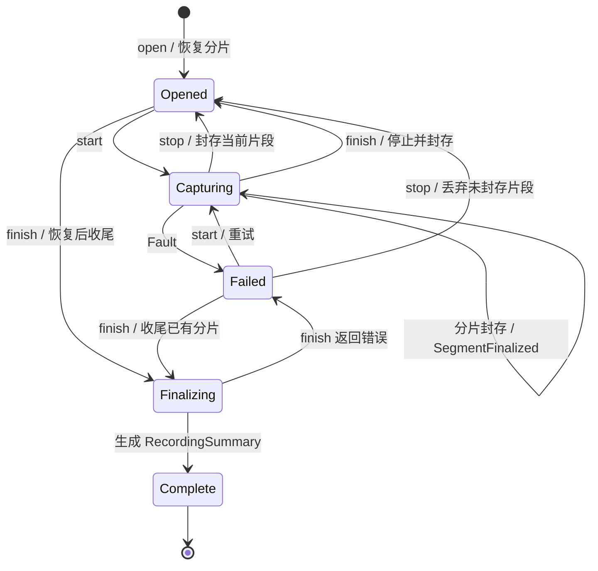

# cvbbmso-recorder — 屏幕录制与录像摘要

本 crate 管理 Windows/macOS 主显示器录屏、分片落盘、异常恢复、合并和 SHA-256 计算。Windows 采用 Desktop Duplication，macOS 采用 ScreenCaptureKit；视频采用 H.264，分片封装为 MKV，最终产物为 MP4。录屏范围为主显示器，音频关闭，文件保留在本地。

编码、容器和系统桥接均为私有实现；本文档定义公开接口、本地文件约定和故障行为。屏幕权限的探测与申请属于 [cvbbmso-client](cvbbmso-client.md)；权限在运行中被撤销时表现为采集故障。

## 公开 Rust API

```rust
use tokio::sync::mpsc::Receiver;

pub struct Recorder { /* 私有录制状态 */ }

pub enum RecorderEvent {
    SegmentFinalized(cvbbmso_protocol::SegmentMeta),
    Fault(RecordingError),
}

pub enum RecordingError {
    Io(std::io::Error),
    Platform(Option<std::io::Error>),
    Encoder(Option<std::io::Error>),
    NoSegments,
    Merge(Option<std::io::Error>),
}

impl Recorder {
    /// 打开考生录像目录并恢复已封存分片。
    /// 返回的接收端从 open 起即可接收恢复分片事件。
    pub async fn open(
        exam_id: uuid::Uuid,
        oj_user_id: i64,
        candidate_dir: std::path::PathBuf,
        policy: cvbbmso_protocol::RecordingPolicy,
    ) -> Result<(Self, Receiver<RecorderEvent>), RecordingError>;

    /// 开始或恢复主显示器录制；已处于采集状态时幂等。
    pub async fn start(&mut self) -> Result<(), RecordingError>;

    /// 停止采集并封存当前片段；合并与摘要由 finish 负责。
    /// 已停止或未在采集时幂等；在 Failed 状态调用只丢弃当前未封存片段，已封存分片保留。
    pub async fn stop(&mut self) -> Result<(), RecordingError>;

    /// 停止采集、封存剩余片段、合并视频并返回录像摘要。
    /// 已完成后重复调用返回同一摘要。如果没有已封存分片，返回 NoSegments。
    pub async fn finish(
        &mut self,
    ) -> Result<cvbbmso_protocol::RecordingSummary, RecordingError>;
}
```

`RecordingError` 是本 crate 唯一的公开错误类型，平台、编码和合并失败都是它的变体，而不是各自独立的枚举。`Io` 携带 `std::io::Error`；`Platform` 携带后端报出的错误，`None` 表示本平台没有采集后端；`Encoder` 携带编码器后端错误，`None` 表示本平台没有编码器；`Merge` 携带合并期间的文件或容器错误。`NoSegments` 是状态判定。来源通过 `#[source]` 保留，使应用层能用 `anyhow` 输出完整因果链。

Windows 后端通过 `std::io::Error` 及其来源链保留原始 `windows::core::Error`，同时补充采集操作名；平台适配层可沿 `source()` 链取回原错误及 HRESULT，公开接口仍不暴露平台类型。

`candidate_dir` 是考生目录 `<app-data>/exams/<exam-id>/<oj-user-id>/`，由运行时传入；`Recorder` 在其中创建 `recording/`。`open` 读取并恢复已封存分片，恢复分片按 `index` 升序通过接收端发送 `SegmentFinalized`。运行时为这些分片复用本地持久化的原 `event.seq`，因此 `open` 可以安全地重复发出全部分片。

`start` 由运行时在收到 `start_exam` 后调用；`stop` 由主动关闭或 `end_at + 60s` 本地截止调用；`finish` 由 `end_exam` 触发。`RecorderEvent::SegmentFinalized` 在分片文件和元信息保存完成后发送；`Fault` 仅表示采集、编码或写盘失败，运行时将其转换为 `recording_failed` 异常并重试。`NoSegments`、`Merge` 由 `finish` 作为错误返回。WebSocket、事件序号和异常记录由运行时负责。

## 文件与分片元信息

```text
<app-data>/exams/<exam-id>/<oj-user-id>/recording/
├── segments/
│   ├── 000001.mkv
│   ├── 000001.json
│   ├── 000002.mkv
│   └── 000002.json
└── final.mp4
```

分片元信息由 [cvbbmso-protocol](cvbbmso-protocol.md) 的 `SegmentMeta` 定义，`index` 从 1 开始并与文件名序号一致：

```json
{
  "index": 1,
  "start_at": "2026-12-20T01:00:00Z",
  "end_at": "2026-12-20T01:00:30Z",
  "sha256": "aaaaaaaaaaaaaaaaaaaaaaaaaaaaaaaaaaaaaaaaaaaaaaaaaaaaaaaaaaaaaaaa"
}
```

`start_at` / `end_at` 是该片段实际录制的起止 UTC 时间，`sha256` 是 `NNNNNN.mkv` 封存后整个文件的 SHA-256。分片索引从 1 连续递增。最终录像摘要包含参与合并的分片数 `segment_count`（正 `u32`）及完整 `final.mp4` 的 `merged_sha256`。

```json
{
  "segment_count": 1,
  "merged_sha256": "bbbbbbbbbbbbbbbbbbbbbbbbbbbbbbbbbbbbbbbbbbbbbbbbbbbbbbbbbbbbbbbb"
}
```

`finish` 在同目录的临时文件中合并视频，写入并同步完成后原子发布 `final.mp4`。录像摘要使用完整文件计算哈希。

## 录像生命周期

Windows 采集线程持有防自动息屏、自动睡眠请求，采集结束或故障退出时恢复该线程原先的请求状态，不修改系统电源配置。手动锁屏、息屏和系统休眠仍可能使桌面采集不可用；运行时保留故障与恢复事件，不补造中断期间的画面。

打开采集对象不代表已经取得画面。只有第一帧被编码输入接受后，`start` 才报告成功；首帧等待超过 5 秒按采集故障返回，交由运行时重试。Windows 平台故障保留采集操作名、HRESULT 和原始错误来源。

采集来源故障时，编码器正常处理过的当前片段先尝试排空并封存，再发布故障事件，以减少中断前已有画面的损失。编码、存储故障不强制发布可疑尾段；封存失败仍保留原始采集故障，并由调用方获得封存错误。连续多次采集故障后继续以连续索引封存可用片段。



- `Failed` 可通过 `start` 重试或通过 `finish` 收尾。采集故障后运行时先上报 `recording_failed`，再调用 `start` 重试；成功后进入 `Capturing` 并上报 `recording_recovered`。重试由运行时控制，recorder 负责单次尝试。
- `finish` 是单次尝试。失败后状态为 `Failed`，允许再次 `finish`；运行时按有界退避重试。合并成功后缓存摘要。再次 `finish` 返回同一摘要。
- `finish` 可从 `Opened` 或 `Failed` 调用，用于考试结束或恢复后的收尾；分片清单为空时返回 `NoSegments`。
- `stop` 封存当前片段；合并与摘要由 `finish` 负责。主动关闭或 `end_at + 60s` 本地截止使用它；之后仍可通过 `finish` 生成摘要。
- 客户端异常退出后，`open` 检索既有分片并恢复可用录制状态；考试仍在进行时由运行时在收到新的 `start_exam` 后调用 `start` 继续录制。
- 考试已结束时，服务端下发 `end_exam`，由 `finish` 收尾并返回录像摘要，供考试运行时上报 `recording_finalized`。
- 录像形成的分片和最终摘要通过 `cvbbmso-exam` 转为 [协议](cvbbmso-protocol.md) 中的可靠 `event` 消息。

## M3 私有采样与原始帧验收

私有 `capture::run` 是同步的采样线程入口，由专用线程调用；后端在同一线程内创建、使用和销毁，以保持 COM 线程归属。它接收 `RecordingPolicy`、停止标志及同步帧消费者。原始帧测试可以单独验收采样器，正式录制由 M5 接入编码和封存。

- 按单调时间的绝对采样点执行，每个 `fps` 定义的采样槽至多交付一帧；采样点按有理数计算并向上取整到纳秒，避免 15 fps 等帧率的累计舍入漂移。
- 消费者同步处理当前帧，不维护积压队列。采集或消费落后时跳过已过去的采样槽，不突发补帧。时间戳取本次发起取帧时的实际单调时间，相对采样开始计算，不使用 GPU 拷贝或消费者处理完成的时间；分片封存仍单独记录实际 UTC 起止时间。
- 第一张图像之前，等待超时不交付空图像；之后无更新时复用缓存图像并推进时间戳。正常等待超时不算故障；真实采集错误和消费者错误原样返回，由上层负责处理。
- Windows 后端忽略 `LastPresentTime == 0` 的仅指针更新，不以尚未呈现的桌面表面初始化缓存，同时仍释放本次取得的帧。此字段含义见 [DXGI_OUTDUPL_FRAME_INFO](https://learn.microsoft.com/en-us/windows/win32/api/dxgi1_2/ns-dxgi1_2-dxgi_outdupl_frame_info)。
- 等待首帧及采样点时以至多 50 ms 为一段检查停止标志；采集调用返回后再次检查，停止后不再交付新帧。消费者必须在有界时间内返回，也可以主动返回 `ControlFlow::Break(())` 结束本次采样。

普通单元测试使用假时钟和假帧源，不进行真实等待。Windows 交互桌面的原始帧验收需显式运行：

```sh
cargo test -p cvbbmso-recorder --locked writes_sampled_frames_from_the_primary_display -- --ignored
```

验收在采集线程上按 5 fps 采样并输出三帧，检查每帧 BGRA 字节数和单调采样槽。在工作区的 `target/recorder-capture-check/capture-*/` 下保留 `000001.bgra` 至 `000003.bgra` 以及 `frames.json`；后者记录 `pixel_format`、`fps`，以及每帧的文件名、宽高、`elapsed_ns`。产物不进入 Git。该测试默认忽略，CI 无须连接显示器。

## M4 BGRA → NV12 转换边界

私有 `encode::Nv12Frame` 为一个固定分辨率持有可复用的 NV12 缓冲区，构造时初始化为 limited-range 黑色；`convert_bgra` 成功后覆盖整帧，不为每次转换重新分配内存。它采用 CPU 转换，按 2×2 块一次读取 BGRA 并生成四个 Y 样本和一对交错 Cb/Cr；当前不依赖 GPU 转换或新增第三方库。

- 输入是顶向下、紧密排列的 8-bit BGRA，alpha 忽略。使用 BT.709 的 Y′CbCr 矩阵和 limited range（Y 16–235，Cb/Cr 16–240），不因 NV12 格式而假定某个默认矩阵。这里只转换非线性 RGB 分量，不实现 HDR、色域映射或传递函数变换。
- 构造器只接受非零偶数宽高，并以 checked arithmetic 检查 BGRA、NV12 字节数及切片长度可表示性；奇数尺寸明确返回错误。若后续流水线支持奇数桌面尺寸，必须先复制边缘像素补齐到偶数，并统一编码尺寸与可见区域，不能裁掉末行/列的色度。
- `convert_bgra` 要求输入长度严格等于 `width * height * 4`，多余或缺少字节均返回错误且保留上一帧。尺寸、输入长度、目标 pitch 等错误通过 `RecordingError::Io(InvalidInput)` 返回；分配失败保留底层原因，不用空缓冲区表示失败。
- 色度取 2×2 RGB 总和后统一加权、舍入，避免提前把每通道平均值截断成整数；16-bit 定点近似相对独立浮点参考允许至多一个码值差异。色度样本在 2×2 块中心，U/V 同相，按 progressive 内容解释。
- 内部布局为 `width * height` 字节 Y 后跟 `width * height / 2` 字节 UV，两平面内部 stride 均为 width。`copy_to` 将每行有效像素拷贝到目标正 stride 缓冲区，UV 从 `stride * height` 开始；它先验证目标大小与溢出，不改动行填充。平台层应传入实际锁定缓冲区的 pitch，不把 compact 布局等同于任意 MF/D3D surface。

Windows 的 `set_color_attributes` 设置 `MF_MT_YUV_MATRIX = BT709`、`MF_MT_VIDEO_NOMINAL_RANGE = 16_235`，以及匹配居中 2×2 采样的 `MF_MT_VIDEO_CHROMA_SITING = MPEG1 | ProgressiveChroma`。`Encoder::open` 会同时把它应用到 NV12 输入和 H.264 输出媒体类型。本机 Microsoft H.264 MFT 未写入对应 VUI，因此矩阵、范围和原色由容器层补充：MKV 写 `Colour`，MP4 写 `colr`/`nclx`。

`nclx` 不承载色度位置；MP4 内 H.264 码流通过 SPS 的 VUI 表达它。编码边界同时为 AVC 配置和样本内 SPS 补齐 `chroma_loc_info_present_flag = 1`、上下场的 `chroma_sample_loc_type = 1`（居中）。修补保留其余 SPS 参数、既有 VUI 的颜色、时序、HRD 与缓冲约束，重新生成 RBSP 对齐和 emulation-prevention 字节；无法安全解析的参数集返回带 source 的错误，不静默回退到左对齐。MKV 的 `Colour` 继续声明居中色度，独立解码器应对最终 MP4 报告 `chroma_location = center`。彩条、灰阶和彩色文字在真实采集流水线中的观感仍须验收。

### M4 输出协商与封装边界

`Encoder::open` 在设置输出类型前通过 `ICodecAPI` 将 `CODECAPI_AVEncMPVDefaultBPictureCount` 置零，使输出按显示顺序单调递增、`PTS = DTS`，因此 MKV 与 MP4 都无需 `ctts` 重排。该属性必须在设置输入类型、开始流式处理之前写入；之后 MFT 将拒绝修改。输入样本必须同时携带时间与时长，否则编码器返回 `MF_E_SAMPLE_HAS_NO_DURATION`。

`MF_MT_MAX_KEYFRAME_SPACING` 和 `CODECAPI_AVEncMPVGOPSize` 都不能让该 MFT 稳定遵守两秒关键帧间隔。`Encoder::encode` 每累计 `2 * fps` 个输入帧就通过 `CODECAPI_AVEncVideoForceKeyFrame` 请求下一个输入帧为关键帧；硬件测试连续编码 150 帧并断言实际 IDR 间隔不超过 30 帧。`Encoder::force_keyframe` 供 M5 在分片轮转时显式请求新分片首帧为关键帧，固定 GOP 间隔不能替代该边界请求。

编码输出按 Media Foundation 的 MFT 协议读取：`GetOutputStreamInfo` 声明输出缓冲区大小且不提供样本，因此每次 `ProcessOutput` 由调用方分配样本；`MF_E_NOTACCEPTING` 表示输出尚未排空，先排空再重试同一输入；`MF_E_TRANSFORM_NEED_MORE_INPUT` 是正常结束；`MF_E_TRANSFORM_STREAM_CHANGE` 时重新设置可用输出类型；`MF_E_BUFFERTOOSMALL` 时扩大缓冲区重试。`dwStatus` 中的 `NO_SAMPLE` 与 `STREAM_END` 分别处理无样本和结束；`flush` 发送 `MFT_MESSAGE_COMMAND_DRAIN`，取回编码器延迟的帧。

输出样本的时间戳取 MFT 样本自身的 100 ns 时间并换算为毫秒；`MFSampleExtension_CleanPoint` 或 IDR（NAL 类型 5）标识关键帧。序列参数集和图像参数集来自输出类型的 `MF_MT_MPEG_SEQUENCE_HEADER`，按 Annex B 拆分后构造 `AvcConfig`。编码器输出的 Annex B 码流统一转换为四字节长度前缀的 NAL 单元，再交给 `MkvWriter`。空输出样本被丢弃，不生成零长度块。

硬件验收测试 `encodes_frames_into_an_elementary_stream` 用真实 MFT 编码十帧、写入 MKV 并重新解析；`merges_encoded_segments_into_a_movie` 进一步把两个真实编码分片合并为 MP4。两者均默认忽略；编码结果的第三方可播放性应在桌面环境用 ffprobe 或播放器人工确认。

## M5 正式录制与分片轮转

`open` 验证并保留 `RecordingPolicy`。同一个 `recording/` 目录由一个实例独占，录制和合并任务在运行期间持有相同的文件锁。进程结束会释放锁。旧版目录无需迁移，既有分片仍按原文件名和哈希恢复。

`start` 等到平台采集初始化成功后返回。首帧到达时创建 H.264 编码器，录制中的采集、编码或封存错误通过 `Fault` 通知运行时。采样频率取策略的 `fps`。BGRA 样本转为 BT.709 limited-range NV12，奇数宽高在右边或底边补黑像素。主显示器尺寸在同一次录制中变化时报告采集故障，已封存分片保留。

以一段首个采样点为起点，当下一帧达到 `segment_duration_secs` 时轮转。录制线程排空并销毁前段的编码器，再用新编码器接收轮转后的第一帧。前段的延迟样本仍写入前段，新段请求关键帧并检查首个输出样本含有 IDR。继续录制时核对编码尺寸和 AVC 配置与已封存分片一致。Windows Media Foundation 会对已排空的编码器恢复输入提出额外要求，因此每段使用独立编码器。[Microsoft 的排空说明](https://learn.microsoft.com/en-us/windows/win32/medfound/mft-message-command-drain)

封存先保存并同步完整 MKV，计算哈希，随后独占发布同编号 JSON。JSON 是封存标记。异常退出若留下只有 MKV 的旧文件，再次使用该序号前会把旧文件保存在同目录的 `*.orphan` 中。已封存分片、旧文件和其他写入者的临时文件均不得覆盖。采集工作线程中断后，Recorder 从磁盘恢复已封存分片，并沿同一事件通道补送尚未排入的分片元信息。下一次录制从最后一个已封存序号继续。

`stop` 请求采样线程停止，并等待编码器排空和当前分片封存。排空或封存失败时返回错误。取消等待会保留停止请求和任务，下次调用继续等待。`finish` 停录后合并已封存分片。

通道满时，分片元信息按序等待转发，停录和合并可以继续。接收端保持打开时，`finish` 成功返回前会等待所有积压事件进入接收端。调用方应在等待 `finish` 时并行读取事件，成功后排空已就绪事件，记录全部分片后再记录最终摘要。关闭或丢弃接收端后，本地合并仍可完成并返回摘要。

合成帧验收通过公开 `Recorder` 方法走采样后的完整路径，覆盖跨段封存与 MP4 合并。需要运行平台编码器时，可显式执行以下测试。

```sh
cargo test -p cvbbmso-recorder --locked records_synthetic_frames_across_rotation_with_the_native_encoder -- --ignored
```

设置 `CVBBMSO_RECORDER_TEST_MP4` 可将合成帧 MP4 写到指定文件用于独立解码。该测试使用合成帧，不读取屏幕。

## M6 合并与最终产物

`finish` 按 `index` 升序读取已封存分片，合并为单视频轨 MP4：

- 每个分片在读取时和复制样本时都重新计算 SHA-256 并与 `SegmentMeta.sha256` 比对；分片缺失、摘要不符、超过读取上限、容器不可读，或各分片的分辨率、AVC 配置不一致时返回 `Merge`，已封存分片保持不变。
- 单个 MKV 分片整段读入内存前应用 512 MiB 上限，单个分片 JSON 应用 64 KiB 上限；上限按实际读取的字节数判断，而不是文件报告的长度。超过上限时合并返回 `Merge`、恢复返回 `Io`，原文件、已封存分片和已有结果保持不变。512 MiB 远高于 4 Mbit/s 目标码率下正常轮转的分片，64 KiB 远高于约 150 字节的 `SegmentMeta` 序列化结果。
- 样本按媒体顺序拼接：每段先以该段首帧时间戳为零点归一化，下一分片的首帧紧接上一分片末帧之后，缺口不会在最终视频中形成冻结画面，非零起点也不会产生额外停顿。实际 UTC 起止时间仍由分片元信息承担证据职责。
- 最后一段的尾帧时长显式传给 MP4 写入器：取该段最后两个样本的间隔，单帧分片取 1 ms；`stts`、`mdhd`、`mvhd` 共用同一时长。
- MP4 由私有写入器直接生成：`ftyp`、`moov`（`mvhd`、单 `trak`、`avc1` + `avcC` + `colr`、`stts`、`stsc`、`stsz`、`stss`，偏移表按大小选择 `stco` 或 `co64`）与 `mdat`。`colr` 使用 BT.709 limited-range 的 `nclx`；样本沿用四字节长度前缀，正好匹配 `avcC` 的 `lengthSizeMinusOne = 3`。MKV 分片的视频轨同样写 `Colour`，其中包含矩阵、范围、原色和居中色度位置。
- 每次 `open` 为后续合并生成独有的同目录临时文件名 `final.mp4.<pid>.<sequence>.tmp`；合并用 `create_new` 独占创建该文件，绝不截断或覆盖已有文件，写入并同步后再重命名为 `final.mp4`。本次尝试失败时只删除它自己创建的文件，不把半成品发布为最终文件；`open` 不清理临时文件，避免删除仍在写入的文件，崩溃遗留的临时文件不参与合并，下次合并使用新的文件名。合并任务在持有 M5 目录锁期间发布最终文件。分片清单为空时仍由 `finish` 返回 `NoSegments`。
- `finish` 在 `spawn_blocking` 中完成解析、哈希、写盘与最终文件哈希，避免在 Tokio worker 上执行长磁盘操作；合并成功后缓存摘要。取消等待事件交付时保留该结果，后续调用继续等待交付。
- 合并任务由 `Recorder` 的 `Finalizing` 状态持有。取消 `finish` 的等待只取消当前等待，不丢弃任务或结果；后续 `finish` 等待同一个任务，成功后返回缓存摘要，失败被观察并进入 `Failed` 后才允许新一轮尝试。`stop` 不丢弃进行中的合并，因此不会因等待超时或重试产生两个同时写入同一临时文件的合并。调用方须在完成收尾前保留同一个 `Recorder`；直接销毁 recorder 不能强制终止已经运行的 blocking I/O。
- 恢复旧分片时，合并输出同时为 `avcC` 与样本内 SPS 补齐居中色度 VUI。样本大小表和实际 `mdat` 使用同一修补规则；原 MKV/JSON 字节及封存哈希不变。缺少色度 VUI 的旧分片可合并；畸形或不支持的 SPS、错误的 NAL 长度前缀返回 `Merge`，不能发布色度位置不明确的最终文件。

## M7 macOS 采集与编码

macOS 后端与 Windows 共享同一组私有接缝：`capture::Desktop`（主显示器采集）和 `encode::Encoder`（H.264）。两者都在采样线程内创建、使用和销毁，平台类型与框架句柄不出现在公开 API 中；依赖使用 `objc2` 0.6 及 `objc2-screen-capture-kit`、`objc2-video-toolbox`、`objc2-core-media`、`objc2-core-video` 0.3，且只在 `target_os = "macos"` 下声明。

- 采集使用 ScreenCaptureKit。`Desktop::open(fps)` 通过 `CGMainDisplayID` 选中主显示器，按其 `CGDisplayPixelsWide/High` 像素尺寸建立 `SCContentFilter` 和 `SCStreamConfiguration`：`kCVPixelFormatType_32BGRA`、隐藏光标、关闭音频、最小帧间隔 `1/fps`。ScreenCaptureKit 队列沿用系统默认深度 3 帧。应用侧另有一个只保留最新图像的单槽。`fps` 只决定系统产出图像的频率；采样节奏仍由 `capture::run` 的绝对采样点决定，Windows 后端接受该参数但不使用它。
- 回调在专用串行 dispatch queue 上检查像素缓冲区为非平面的 BGRA，锁定期间验证基地址、行间距和可读范围，只复制每行的可见像素以构建紧密排列的 BGRA `Frame`，随后写入应用侧单槽：采样器未消费的旧帧会被新帧覆盖，因此慢消费者不会在画面变化后继续录制旧内容，静止桌面也不会把最后一次变化挡在旧帧后面。槽位同时记录流停止原因，`next_frame` 先交付已捕获的图像再报告错误。超时内没有新图像时返回 `None`，静止桌面与 Windows 一样属于正常等待。
- 屏幕录制权限被撤销或系统停止流时，`SCStreamDelegate` 记录 `NSError`，之后每次 `next_frame` 都返回带 source 的 `RecordingError::Platform`，不会退化成“静止画面”。权限探测与申请仍由客户端负责，本 crate 只把运行中的中断表现为采集故障。
- 编码使用 VideoToolbox。`Encoder::open(width, height, fps, bitrate)` 创建 `VTCompressionSession`：输入为 NV12 `kCVPixelFormatType_420YpCbCr8BiPlanarVideoRange`（BT.709 limited range，与 `Nv12Frame` 的 CPU 转换一致）、关闭帧重排（无 B 帧，输出按显示顺序单调递增）、`RealTime`、目标码率、`MaxKeyFrameInterval = 2 * fps`。分片轮转通过 `kVTEncodeFrameOptionKey_ForceKeyFrame` 让下一帧成为 IDR，不依赖固定 GOP。
- VideoToolbox 只在第一帧输出后给出 SPS/PPS，因此 `open` 先编码一帧 limited-range 黑色图并立即 flush，丢弃该样本并缓存参数集，使 `config()` 在第一个真实帧之前就可用；随后第一个真实帧被强制为 IDR。呈现时间戳以微秒为 timescale 严格递增，回调把 `PTS / timescale` 换算成毫秒。
- 输出是四字节长度前缀的 AVCC 访问单元；`Sample::from_access_unit` 校验分帧、从 IDR NAL 识别关键帧，并把样本内 SPS 修补为居中色度，与 MKV/MP4 的 `AvcConfig` 一致。输出异步到达：`encode` 返回当前已完成的样本；`flush` 在独立线程上调用 `VTCompressionSessionCompleteFrames` 并等待全部已提交帧完成，十秒上限覆盖阻塞调用本身和它触发的回调。排空超时后编码器进入 detached 状态，会话与回调状态由该线程持有到阻塞调用返回，后续 `encode`/`flush` 返回 `Encoder` 错误。
- 回调收到非零 `OSStatus` 时保存原始状态码并作为编码故障上报，不会被当作丢帧而静默成功；首个失败保留到下一次 `encode`/`flush` 返回。
- 硬件验收测试默认忽略：`writes_sampled_frames_from_the_primary_display` 需要屏幕录制权限与显示器，`encodes_frames_into_an_elementary_stream` 需要 VideoToolbox。在 macOS 桌面上运行：

  ```sh
  cargo test -p cvbbmso-recorder --locked -- --ignored
  ```
