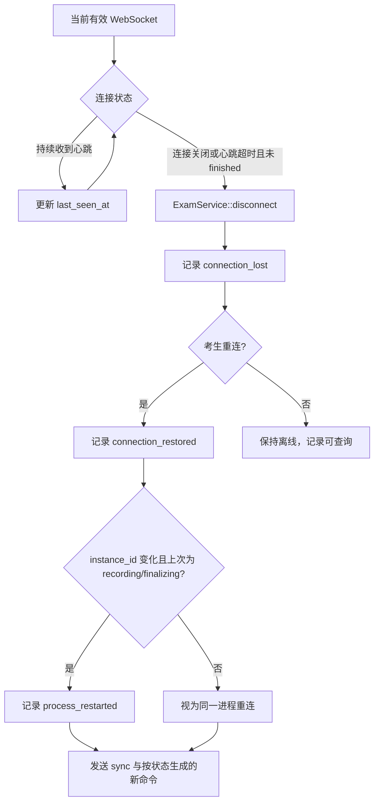

# cvbbmso-server — Axum HTTP / WebSocket 服务

本 crate 提供监考服务端可执行程序。Axum 负责 `/api` 路由、Cookie 认证和 WebSocket 升级；`cvbbmso-domain` 负责考试规则与数据持久化；`cvbbmso-accoding` 负责向 Accoding 学生站复验身份。

本文档定义 HTTP/WS 端点、错误映射、连接职责和部署边界；路由 handler、WS Hub、计时器等内部实现保持 crate 私有。

## Rust 入口

```rust
// 本 crate 为二进制程序，接口保持 crate 私有。
struct ServerConfig {
    listen_addr: std::net::SocketAddr,
    database_url: String,
    heartbeat_timeout_secs: u64,
}

enum ServerError {
    Config,
    Database,
    Io,
}

async fn serve(config: ServerConfig) -> Result<(), ServerError>;
```

`serve` 先绑定监听地址，再打开数据库并恢复遗留在线记录。恢复成功后才启动 HTTP Router、WebSocket 连接管理器和考试调度任务。`heartbeat_timeout_secs` 默认 25 秒。服务端按单实例部署，TLS 由反向代理终止；Rust 进程监听内网 HTTP/WS。客户端与服务端同版本部署。

## HTTP API

| 方法 | 路径 | 认证 | 成功响应 | 语义 |
| --- | --- | --- | --- | --- |
| `GET` | `/api/health` | 无 | `200 {"status":"ok"}` | 服务存活检查 |
| `GET` | `/api/exams` | Accoding Cookie | `200 ExamListResponse` | 返回当前考生报名的考试 |
| `GET` | `/api/exams/{exam_id}/ws` | Accoding Cookie | `101 WebSocket Upgrade` | 连接或重连指定考试 |

`exam_id` 是 UUID。客户端在 `GET /api/exams` 和 WS Upgrade 时显式发送 `Cookie: connect.sid=...`，服务器调用 Accoding `/api/users/me` 复验，得到 `oj_user_id`，再按 `(exam_id, oj_user_id)` 检查报名及运行记录。业务标识为 `(exam_id, oj_user_id)`。

错误响应为：

```json
{"error":{"code":"ACCODING_AUTH_EXPIRED","message":"Accoding login required"}}
```

| HTTP 状态 | `error.code` | 语义 |
| --- | --- | --- |
| `400` | `INVALID_REQUEST` | 参数、路径、请求格式或 Cookie 无效，包括重复的 `connect.sid` |
| `401` | `ACCODING_AUTH_EXPIRED` | 会话 Cookie 缺失、为空或已失效，或 Accoding 返回匿名状态 |
| `403` | `NOT_ENROLLED` | 访问者不在该考试的报名名单中 |
| `404` | `EXAM_NOT_FOUND` | 指定的考试不存在 |
| `500` | `INTERNAL_ERROR` | 内部错误 |
| `503` | `ACCODING_UNAVAILABLE` | Accoding 身份服务暂时不可用 |

错误码本身由 [cvbbmso-protocol](cvbbmso-protocol.md) 定义；本表维护 HTTP 状态码映射。同一考生从新设备连接时，服务端按“替换旧连接”处理。

HTTP 与 WebSocket 拒绝日志同时记录协议错误码和经过脱敏的失败原因。日志仅记录错误类别和安全诊断字段，例如上游 HTTP 状态与 SQLite 错误号。客户端继续收到协议错误码和通用文案。

## WebSocket 处理

协议端点为 `wss://<监考服务端>/api/exams/{exam_id}/ws`。服务端在升级前从握手 Cookie 确认考生身份，失败时按上表返回同格式的 HTTP 错误。升级成功后，客户端先发送 `hello`，服务端调用 `ExamService::connect(exam_id, oj_user_id, hello)` 返回 `sync` 和待下发的新命令。后续 `heartbeat`、`status`、`event` 交给 `ExamService::receive`，会话校验 `command_result` 后交给 `ExamService::record_command_result`。

所有考试的入站 WebSocket 单帧载荷和重组后整条消息均以 64 KiB（65,536 字节）为上限，超限时返回 `PROTOCOL_ERROR` 并关闭连接。每条连接最多有一条应用消息在共享队列中等待或处理。所有消息字段见 [cvbbmso-protocol](cvbbmso-protocol.md)。

命令与确认规则：

- 服务端根据 `hello.state` 和考试阶段生成命令；每个命令生成新的唯一 `command_id`。
- 调度器向在线连接推送 `due_commands` 返回的命令；离线考生的命令在重连时由 `connect` 生成。
- 事件确认通过 `sync.ack_event_through` 返回；服务端持久化连续事件并在重连时通过 `sync` 返回确认位置。
- 收到 `command_result` 后，服务端在同一事务归档终态并更新考生状态，提交后回复 `CommandAck { command_id }`。会话内重报相同结果会收到相同 ACK；命令 ID 必须由当前会话发出。非法状态组合或未知命令按 `COMMAND_STATE_CONFLICT` / `PROTOCOL_ERROR` 处理，并在协议错误时关闭连接。
- `CommandAck` 丢失后，客户端可用 `finalizing` 重连。服务端保留已提交的完成状态，并下发新的 `end_exam` 让客户端重报终态。
- 考前撤销报名时，服务端将运行记录设为离线并保留此前证据。旧连接继续发送业务消息时会被关闭。
- `status` 用于状态对齐；同一连接内执行阶段倒退由 domain 拒绝，映射为 `PROTOCOL_ERROR` 并关闭连接，原状态保留。结束状态由 `end_exam` 的 `command_result` 判定。重连仍按 `hello.state` 重新生成命令。

同一 `(exam_id, oj_user_id)` 同时保留一条有效 WebSocket。服务端维护“当前连接”：

- 新连接到达时替换旧连接，并关闭旧 socket；旧 socket 之后触发的关闭事件按替换结果处理。
- 服务端对处于 `finished` 的连接按正常完成处理；其余当前连接的关闭或心跳超时调用 `ExamService::disconnect`。
- 收到 `end_exam` 的 `command_result` 后，服务端将执行状态置为 `finished`，回复 `CommandAck`；该连接随后关闭，属于正常完成。
- 被替换的旧连接以 `Replaced` 原因记录 `connection_lost`，`detail` 为 `replaced`。

## 连接丢失与恢复



- 客户端异常退出或网络中断时，服务器观测到 WebSocket 关闭或心跳超时，记录 `connection_lost`。客户端退出后保持离线时，CLI 仍能查到该记录。
- 重连成功时，根据旧记录的在线状态和执行阶段记录失联与恢复。若新 `hello.instance_id` 与上次不同且上次状态为 `recording/finalizing`，再记录 `process_restarted`。三条记录独立保存，CLI 按 `occurred_at`、`incident_id` 排序展示。
- 服务端启动时恢复遗留在线记录，给未完成的考生记 `connection_lost`，`detail` 为 `server_restart`。
- SQLite 忙锁时，同一消息最多尝试写入四轮，轮间等待 50 毫秒。到达当前心跳截止时间或观察到传输关闭后，停止后续重试。只有成功写入的心跳才按接收时间续期。等待重试期间最多预读一条后续消息，按接收顺序处理。心跳到期前耗尽尝试次数时，发送既有的 `INTERNAL_ERROR` 并关闭连接。
- 已开始的事务先结算，再处理断开或接纳替代连接。断开写入失败时保留观察时间并重试，成功后该考生才能重新接入。
- 正常完成考试时连接静默关闭，按正常完成处理。

## 模块协作

`cvbbmso-server` 拥有 HTTP/WS 传输及连接生命周期。身份校验委托 `cvbbmso-accoding`，考试授权、时序、ACK、异常保存委托 `cvbbmso-domain`。CLI 直接访问领域层，服务器提供 HTTP/WS 服务。
