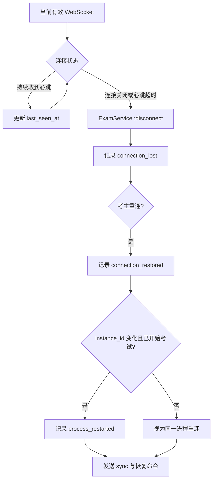

# cvbbmso-server — Axum HTTP / WebSocket 服务

本 crate 提供监考服务端可执行程序。Axum 负责 `/api` 路由、Cookie 认证和 WebSocket 升级；`cvbbmso-domain` 负责考试规则与数据持久化；`cvbbmso-accoding` 负责向 Accoding 学生站复验身份。

本文档定义 HTTP/WS 端点、错误映射、连接职责和部署边界；路由 handler、WS Hub、计时器等内部实现保持 crate 私有。

## Rust 入口

```rust
// 本 crate 为二进制程序，接口保持 crate 私有。
struct ServerConfig {
    listen_addr: std::net::SocketAddr,
    database_url: String,
    heartbeat_timeout_secs: u64,
}

enum ServerError {
    Config,
    Database,
    Io,
}

async fn serve(config: ServerConfig) -> Result<(), ServerError>;
```

`serve` 创建 HTTP Router、WebSocket 连接管理器和考试调度任务。`heartbeat_timeout_secs` 默认 25 秒。服务端按单实例部署，TLS 由反向代理终止；Rust 进程监听内网 HTTP/WS。客户端与服务端同版本部署。

## HTTP API

| 方法 | 路径 | 认证 | 成功响应 | 语义 |
| --- | --- | --- | --- | --- |
| `GET` | `/api/health` | 无 | `200 {"status":"ok"}` | 服务存活检查 |
| `GET` | `/api/exams` | Accoding Cookie | `200 ExamListResponse` | 返回当前考生报名的考试 |
| `GET` | `/api/exams/{exam_id}/ws` | Accoding Cookie | `101 WebSocket Upgrade` | 连接或重连指定考试 |

`exam_id` 是 UUID。客户端在 `GET /api/exams` 和 WS Upgrade 时显式发送 `Cookie: connect.sid=...`，服务器调用 Accoding `/api/users/me` 复验，得到 `oj_user_id`，再按 `(exam_id, oj_user_id)` 检查报名及运行记录。业务标识为 `(exam_id, oj_user_id)`。

错误响应为：

```json
{"error":{"code":"ACCODING_AUTH_EXPIRED","message":"Accoding login required"}}
```

| HTTP 状态 | `error.code` | 语义 |
| --- | --- | --- |
| `400` | `INVALID_REQUEST` | 参数、路径、请求格式或 Cookie 无效，包括重复的 `connect.sid` |
| `401` | `ACCODING_AUTH_EXPIRED` | 会话 Cookie 缺失、为空或已失效，或 Accoding 返回匿名状态 |
| `403` | `NOT_ENROLLED` | 访问者不在该考试的报名名单中 |
| `404` | `EXAM_NOT_FOUND` | 指定的考试不存在 |
| `500` | `INTERNAL_ERROR` | 内部错误 |
| `503` | `ACCODING_UNAVAILABLE` | Accoding 身份服务暂时不可用 |

错误码本身由 [cvbbmso-protocol](cvbbmso-protocol.md) 定义；本表维护 HTTP 状态码映射。同一考生从新设备连接时，服务端按“替换旧连接”处理。

## WebSocket 处理

协议端点为 `wss://<监考服务端>/api/exams/{exam_id}/ws`。服务端在升级前从握手 Cookie 确认考生身份，失败时按上表返回同格式的 HTTP 错误。升级成功后，客户端先发送 `hello`，服务端调用 `ExamService::connect(exam_id, oj_user_id, hello)` 返回 `sync` 和待执行指令。后续消息 `heartbeat`、`status`、`event`、`command_result` 交给 `ExamService::receive`，服务端向客户端推送 `sync`、`command`、`ack` 和 `error`。所有消息字段见 [cvbbmso-protocol](cvbbmso-protocol.md)。

同一 `(exam_id, oj_user_id)` 同时保留一条有效 WebSocket。服务端维护“当前连接”：

- 新连接到达时替换旧连接，并关闭旧 socket；旧 socket 之后触发的关闭事件按替换结果处理。
- 服务端为当前连接的关闭或心跳超时调用 `ExamService::disconnect`。
- 正常完成考试（收到 `execution=finished` 后的最终 ACK）时，服务端静默关闭连接；`connection_lost` 由 `disconnect` 生成。
- 被替换的旧连接以 `Replaced` 原因记录 `connection_lost`，`detail` 为 `replaced`。

调度器调用 `ExamService::due_commands`，按考生当前连接推送命令；重连后补发的命令保留在领域层。重发使用既有 `command_id`；客户端按 `command_id` 幂等回复终态。`CommandResult` 表示 `completed` / `failed`，投递细节由服务端内部处理。

## 连接丢失、恢复与重启



- 客户端进程被终止时，服务器观测到 WebSocket 关闭或心跳超时，记录 `connection_lost`。客户端退出后保持离线时，CLI 仍能查到该记录。
- 重连成功时记录 `connection_restored`；若新 `hello.instance_id` 与上次不同且考生已开始考试（`execution` 为 recording / finalizing / finished），再记录 `process_restarted`。三条记录独立保存，CLI 按 `occurred_at` 排序展示。
- 服务端重启时，重启前处于连接状态的考生由服务端记录 `connection_lost`，`detail` 为 `server_restart`；客户端重连后记录 `connection_restored`。`detail` 用于区分运维事件与考生侧连接丢失。
- 正常完成考试时连接静默关闭，`connection_lost` 由 `disconnect` 生成；客户端在考试结束、最终摘要 ACK 后关闭连接。

## 模块协作

`cvbbmso-server` 拥有 HTTP/WS 传输及连接生命周期。身份校验委托 `cvbbmso-accoding`，考试授权、时序、ACK、异常保存委托 `cvbbmso-domain`。CLI 直接访问领域层，服务器提供 HTTP/WS 服务。
