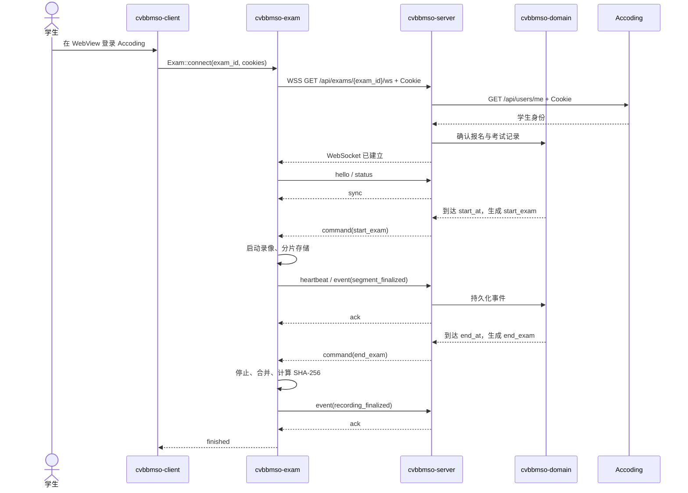
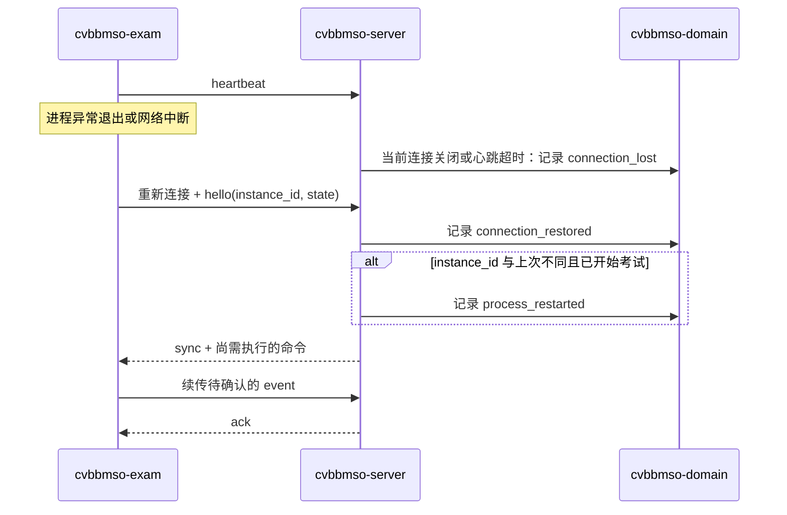

# cvbbmso — 系统总览

`cvbbmso` 是面向 Windows、macOS 的程设考试客户端和监考服务端。学生通过内置受控浏览器访问 [Accoding](https://accoding.buaa.edu.cn)，服务端使用 Accoding 的 `connect.sid` Cookie 复验学生身份。考试时间由服务器统一控制：服务器通过单条 WebSocket 连接下发开始、结束指令；客户端在同一连接中发送心跳、运行状态、异常事件与录像摘要。

本文档定义系统边界、术语、模块职责和跨模块协作。各 crate 文档定义自己的公开接口、职责和跨模块行为；数据库表结构、内部状态机、线程/任务划分由实现决定。

建议阅读顺序：`overview` → `protocol` → `domain` / `server` → `exam` / `client` / `recorder` / `network` / `accoding` → `cli`。

## 术语

| 术语 | 含义 |
| --- | --- |
| `exam_id` | 考试 UUID，由管理员创建考试时生成 |
| `oj_user_id` | Accoding `/api/users/me` 返回的正整数用户 ID |
| `(exam_id, oj_user_id)` | 考生参加某场考试的唯一业务标识 |
| `phase` | 考试阶段 `scheduled` / `running` / `ended`，由服务端时钟和固定考试时间推导 |
| command | 服务端下发的 `start_exam` / `end_exam` 指令，具有稳定的 `command_id` |
| event | 客户端可靠、顺序上报的业务事件，带 `(exam_id, oj_user_id, seq)` 标识 |
| incident | 异常证据记录，以 `occurred_at` 标识发生时间；每次发生保存一条记录 |
| segment | 一段已封存的录像分片，带 1-based `index`、起止时间和 SHA-256 |
| manifest | 一次录像的完整摘要，包含全部分片和合并后文件的 SHA-256 |
| recording | 客户端本地录屏产物；服务端保存摘要 |
| ACK | 服务端对连续事件的确认序号 `ack_event_through` |

## 范围边界

- 录像保留在客户端，服务端保存摘要；设备号、分片哈希和客户端异常作为辅助证据。
- 录屏范围为主显示器，音频关闭。
- 部署形态为单实例；TLS 由反向代理终止。
- 客户端与服务端同版本部署。
- 业务标识为 `(exam_id, oj_user_id)`。
- 文档契约覆盖公开接口、职责和跨模块行为；表结构、索引和迁移由实现决定。
- 一个客户端进程同时承载一场活动考试。

## Workspace 与文档

```text
cvbbmso/
├── Cargo.toml
├── crates/
│   ├── cvbbmso-protocol/   # 共用 HTTP / WebSocket DTO、枚举、错误码
│   ├── cvbbmso-accoding/   # Cookie 处理、Accoding 身份验证
│   ├── cvbbmso-network/    # 系统代理和网络状态检查
│   ├── cvbbmso-recorder/   # 分段录屏、恢复、合并、哈希
│   ├── cvbbmso-exam/       # 客户端考试运行时、WS、本地事件队列
│   ├── cvbbmso-client/     # Tauri 桌面程序和受控浏览器
│   ├── cvbbmso-domain/     # 考试调度、持久化、异常记录
│   ├── cvbbmso-server/     # Axum HTTP / WebSocket 服务
│   └── cvbbmso-cli/        # 服务端本机管理 CLI
└── docs/
    ├── overview.md
    └── crates/
        └── <每个 crate 对应的 cvbbmso-*.md>
```

## Crate 职责与协作

| Crate | 负责内容 | 向其他 crate 暴露的接口 | 文档 |
| --- | --- | --- | --- |
| `cvbbmso-protocol` | 共用 DTO、封闭枚举、线上错误码 | 数据结构、枚举、错误码 | [协议](crates/cvbbmso-protocol.md) |
| `cvbbmso-accoding` | Cookie 归一化及学生站 `/api/users/me` 复验 | `AccodingCookies`、`Verifier` | [认证](crates/cvbbmso-accoding.md) |
| `cvbbmso-network` | 系统代理配置、监考服务端连通性检查 | `Inspector::check`、`NetworkReport` | [网络](crates/cvbbmso-network.md) |
| `cvbbmso-recorder` | 主显示器录屏、分片、恢复、合并、SHA-256 | `Recorder::open/start/finish`、`RecorderEvent` | [录像](crates/cvbbmso-recorder.md) |
| `cvbbmso-exam` | 客户端考试运行时、WS 重连、可靠上报、本地状态 | `Exam::connect`、`ExamHandle` | [运行时](crates/cvbbmso-exam.md) |
| `cvbbmso-client` | WebView、Cookie Store、状态 UI | 可执行程序、Tauri commands | [客户端](crates/cvbbmso-client.md) |
| `cvbbmso-domain` | 考试规则、调度、报名、状态、异常和录像摘要 | `ExamService`、`AdminService` | [领域](crates/cvbbmso-domain.md) |
| `cvbbmso-server` | `/api`、Cookie 鉴权、WS 连接和指令推送 | HTTP / WebSocket 端点 | [服务端](crates/cvbbmso-server.md) |
| `cvbbmso-cli` | 创建考试、配置考生、查询状态/事件/异常/录像 | Clap 命令 | [CLI](crates/cvbbmso-cli.md) |

依赖关系：

- `client → exam → recorder/network/accoding/protocol`
- `client → accoding/protocol`
- `server → domain/accoding/protocol`
- `cli → domain/protocol`
- `domain → protocol`
- `recorder → protocol`
- `accoding → protocol`

`protocol` 是纯数据层，依赖方向为业务 crate → protocol。录屏系统接口封装在 `recorder` 内部，代理平台代码封装在 `network` 内部，数据库与任务调度封装在 `domain` 内部；跨 crate 共享必要的数据类型和操作入口。

## 核心业务规则

- **唯一性**：每场考试的每名 Accoding 考生对应一条考试记录，以 `(exam_id, oj_user_id)` 唯一标识；重连沿用既有记录及事件序号。
- **固定时间**：`start_at` / `end_at` 由管理员创建考试时确定。`phase` 由服务端时钟推导：开始前 `scheduled`，进行中 `running`，结束后 `ended`。
- **连接**：一名考生对同一考试保持一条有效 WSS。新连接替换旧连接；服务端维护当前连接，并对当前连接上报关闭，旧连接的关闭事件按替换结果处理。正常完成考试时连接静默关闭，`connection_lost` 由异常断开、心跳超时、连接替换或服务端重启产生。不同设备连接按替换处理。
- **命令**：服务端在开始、结束时下发 `start_exam` / `end_exam`；迟到、重连或进程重启时复用既有 `command_id` 重发。客户端按 `command_id` 幂等执行，公共结果为 `completed` / `failed`。
- **录像**：客户端接到开始命令后录制主显示器，音频关闭；每段元信息包含 `index`、`start_at`、`end_at`、`sha256`；合并结束后上报 `merged_sha256`。录像保留在客户端，服务端保存摘要。
- **异常**：每条异常以 `occurred_at` 记录发生时间。服务端记录 `connection_lost`、`connection_restored`、`process_restarted`；客户端上报的代理、录屏和导航异常作为独立证据记录。CLI 按时间排序关联。
- **认证**：原生客户端使用 WebView Cookie Store 中的 Accoding Cookie 连接服务端；服务端向学生站 `/api/users/me` 复验，并以返回身份作为唯一登录凭据。

## 部署边界

- 单实例部署。WebSocket Hub 和考试调度器可假定单进程内存状态。
- TLS 由反向代理终止；Rust 进程监听内网 HTTP/WS。对外地址为 `wss://<监考服务端>/api/exams/{exam_id}/ws`。
- 客户端与服务端同版本部署；协议按同版本契约设计。
- 管理入口是服务端本机 CLI，直接调用领域层。
- 服务端重启视为运维事件：重启前处于连接状态的考生记录 `connection_lost`，`detail` 为 `server_restart`；客户端重连后记录 `connection_restored`。CLI 通过 `detail` 区分运维事件与考生侧连接丢失。

## 协作时序



## 连接丢失、恢复与重启



- `connection_lost`、`connection_restored`、`process_restarted` 是三条独立记录，CLI 按 `occurred_at` 排序展示。
- 客户端异常退出后保持离线时，CLI 仍能查到 `connection_lost`。
- 录屏文件按考试与考生本地归档；客户端重新启动后恢复已封存分片。考试尚在进行时由服务端重新下发开始指令；考试已结束时下发结束指令用于收尾。
- 客户端断网跨过 `end_at` 时，按 `sync.server_time` 校正后的 `end_at + 60s` 停止并封存录像；重连后再补报事件和完成收尾。

## 协议归属

线上字段、枚举值、时间格式、错误码、事件顺序与 ACK 定义以 [cvbbmso-protocol](crates/cvbbmso-protocol.md) 为准；HTTP 状态码映射归 [cvbbmso-server](crates/cvbbmso-server.md)；考试规则、调度和异常记录语义归 [cvbbmso-domain](crates/cvbbmso-domain.md)。每个 crate 文档定义其拥有的公开 Rust 接口、职责及跨模块行为，具体实现留在源码中。
